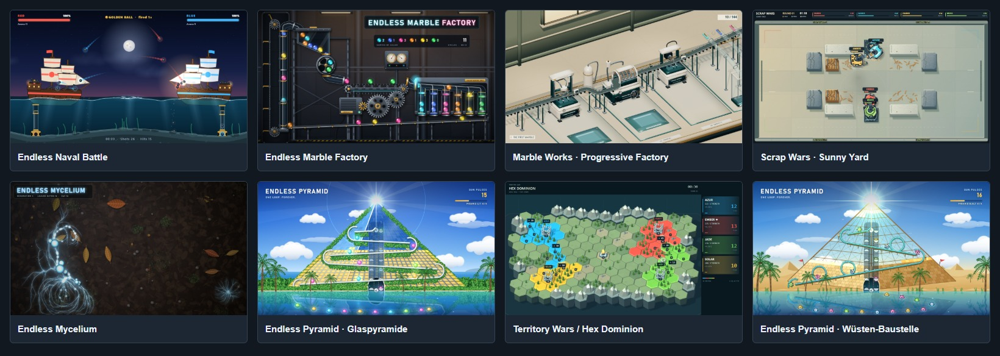
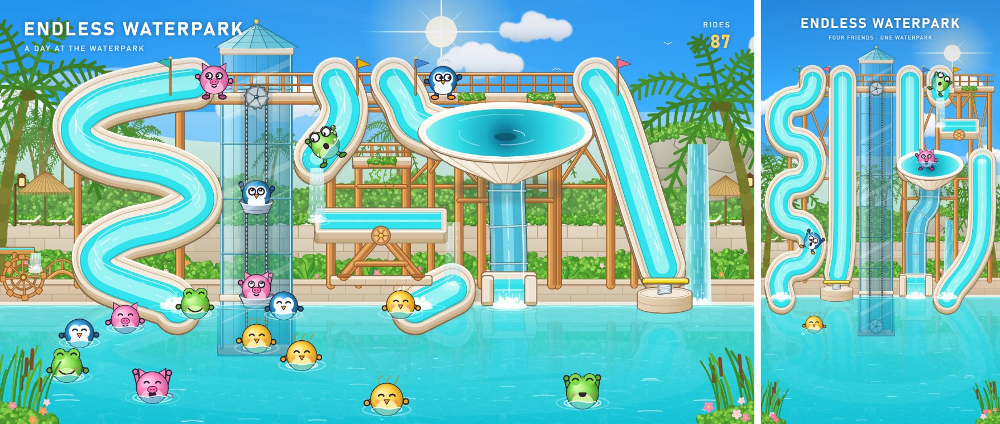

# Endless Battle Simulator

Acht deterministische Simulationen für Battle- und „Satisfying“-Videos mit Browser-Vorschau und MP4-Export inklusive Ton. Mit 2D-Szenen und einer 3D-Produktionsanlage in Marble Works.

**[▶ Online-Vorschau öffnen](https://emfau88.github.io/Endless-Battle-Simulator/)** · [Produktionsvorlagen](presets/production/) · [Roadmap](docs/ROADMAP.md) · [Changelog](docs/CHANGELOG.md)

*Echte Aufnahmen aus dem Projekt. Zum Vergrößern anklicken; die Wüsten-Baustelle ist eine Variante von Pyramid.*

*Neu: **Endless Waterpark**, das achte Szenario. Links der Parktag im Querformat, rechts der Short im Hochformat.*

## Szenarien und Varianten

Die folgenden Szenarien und Varianten sind im aktuellen Code vorhanden. Weitere Regler steuern Mengen, Tempo, Kamera, Effekte und Ton.

| Szenario | Inhalt und wählbare Varianten | Videoende / Ausschnitte |
|---|---|---|
| **Endless Naval Battle** `naval` | Seeschlacht mit **2, 3 oder 4 Schiffen** und Kanonenkugel-Kreislauf. Optional: goldene Kugel, Himmelsverlauf, Sternschnuppen und Wal. **Modi:** Endlos (Standard); Ruhiges Duell (in Arbeit, `--param mode=calm`) mit zwei Kanonen je Schiff, halbem Tempo, kleineren Schiffen und Segelschäden; gespielt in Runden mit Versenkung und Punktestand. | Freie Dauer |
| **Endless Marble Factory** `marble` | Klassische Kugelfabrik mit geschlossenem Sortierkreislauf; eigenes Hoch- und Querformatlayout. **20–35 Kugeln**, 1–3 Kugeln je Farbröhre. | Freie Dauer |
| **Marble Works · Progressive Factory** `marbleworks` | 3D-Fabrik mit Produktionsauftrag und zwei Ausbauten. **Material:** Glas, Stahl, Gummi, Materialvergleich. **Veredelung:** Farbspirale, Klarglas / Vollton, Perlmutt. **Kollektion:** Spektrum, Ozean, Glut. Aufträge mit 24–360 Kugeln; automatische Kamera, Übersicht oder manuelle Ansicht. | Auftrag + Finale oder freie Dauer; **Clip-Export** |
| **Scrap Wars** `scrap` | Roboterkämpfe. **Arenen:** Scrapyard, Foundry, Crossroads, Sunny Yard. Scrapyard und Sunny Yard haben in V3 einen eigenen Hochformat-Grundriss. **Regeln:** Materialarena (`v3`), bisherige Arena (`v2`), Originalprototyp (`classic`); Sunny Yard nutzt immer V3. **Modi:** freie Videolänge mit optionalen Folgerunden oder Turnier mit insgesamt 8 Runden. Experimentelle Turnier-Werkstatt mit Plating, Drive oder Capacitor. | Freie Dauer oder vollständiges Turnier; **Clip-Export** |
| **Endless Mycelium** `mycelium` | Wachstumszyklus aus Myzel, Laub, Pilzen und Sporen mit neuen Generationen. **Farben:** Wechselnd (Mint, Violett, Bernstein, Blau), Nur Mint, Kühle Töne, Warme Töne. | Freie Dauer |
| **Endless Pyramid** `pyramid` | **Kulissen:** Glaspyramide in der Lagune oder Wüsten-Baustelle mit wachsender Pyramide. **Figuren:** Leuchtkugeln oder Tierchen (Küken, Pinguin, Schweinchen, Frosch). Tageslauf, Lichtfüllung / Aufbau und Feuerwerk einstellbar. | Freie Dauer; Tageslauf und Finale konfigurierbar |
| **Territory Wars · Hex Dominion** `territory` | Vier Reiche auf einer Hexkarte. **Profile:** Ruhiger Aufbau, Gebietskrieg, Intensive Front, Blitz (Short), Eigene Einstellungen. **Karten:** Querformat, Hochformat und eine kleine Short-Karte mit Drehbuch „Die letzte Krone“ (ein ganzer Krieg in rund 30 Sekunden). **Anzeige:** voll, schlank für Shorts oder aus. **Einheiten:** Panzer wie im Original oder Speerträger. Perspektive oder Draufsicht; optionale Folgerunden. | Freie Dauer oder bis zum Sieg |
| **Endless Waterpark** `waterpark` | Die vier Pyramid-Tierchen (Küken, Pinguin, Schweinchen, Frosch) in einem hellen Oasen-Wasserpark. Ein gläserner Becherlift bringt sie auf das Startdeck. **Vier Attraktionen:** Panoramarutsche, Trichter mit Glasrohr, Wippe mit Gegengewicht und Anschlägen, steile Rutsche mit Sprungbrett. Alle enden in der Lagune, der Rücklauf zum Lift ist sichtbar. **Eigener Grundriss je Format:** Halbtotale im Querformat; im Hochformat steht der Turm in der Mitte und jede Attraktion hat ihre eigene Spur. Tageslauf bis in die Nacht, Öffnungsprogramm, Wasserspiele in der Lagune, UFO und weitere Himmelsgäste, springende Fische, Sprechblasen, ruhiger Wasserklang. Anzeige im Video englisch; der Titel ist abschaltbar und standardmäßig aus. | Vier-Tiere-Short, Parktag mit Fontänenshow in bunten Farben oder Abendruhe, oder Dauerbetrieb; Vorprüfung für endliche Filme |

**In Arbeit:** **Cloud Wars** (`cloudwars`): Team-Wolken über einer Landschaft von oben ([Plan](docs/CLOUD_WARS_PLAN_2026-11-18.md)). Gelände je Seed und Team-Wolken, die fressen und wachsen; noch ohne Gewitter, Anzeige und Ton.

**In Arbeit:** **Marble Factory XL** (`marblexl`) ist eine Produktionslinie mit neun Stationen im Stil der klassischen Kugelfabrik (Waschen, Polieren, Ofen, Farbe, Trocknen, Prüfen, Sortieren). Bewegter Entwurf im Querformat mit fester Übersicht, läuft in Chargen zu 48 Kugeln beliebig lange durch, noch ohne Warteschlangen, Kapitel und Vorlagen; Schalter „Schilder zeigen“ (Standard aus). Stand und Grenzen: [docs/MARBLE_XL_STUFE_1_2026-11-16.md](docs/MARBLE_XL_STUFE_1_2026-11-16.md).

## Was lässt sich exportieren?

**Alle acht Szenarien samt Varianten** unterstützen den Videoexport.

| Ausgabe | Möglichkeiten |
|---|---|
| **Video** | MP4 / H.264, optional mit AAC-Ton (48 kHz, Stereo); Lautstärke gesamt und je Klang einstellbar |
| **Bildformat** | 9:16 und 16:9; zusätzlich 1:1 (nur per Konfiguration / Kommandozeile). Quadrat nutzt teils ein eingepasstes Querformatlayout. |
| **Qualität** | 720p, 1080p, 1440p oder 4K (kurze Bildseite); 30 oder 60 fps. |
| **Länge** | Frei von 1 Sekunde bis 4 Stunden. Marble Works kann bis zum Auftragsende + 12 Sekunden Fabrikfinale laufen (bei Zeitlupe länger); Scrap-Turniere enden nach 8 Runden + 5 Sekunden Ergebnisanzeige. |
| **Ausschnitte** | Nur **Scrap Wars, Marble Works und Waterpark** (Kommandozeilenfunktion). Der Ton stammt aus der vollständigen Episodenmischung. |
| **Einzelbild** | PNG (Skriptfunktion, kein eigener Button in der Oberfläche) |
| **Einstellungen / Wiederholung** | Einstellungen als JSON speicherbar. Jedes MP4 erhält außerdem eine JSON mit Konfiguration, Seed, Aufnahmeparametern, Prüfsummen und Programmstand. |

Die Online-Vorschau ist stumm und exportiert keine Videos. Gleiche Einstellungen und gleicher Programmstand ermöglichen reproduzierbare Simulationsabläufe; identische Pixel über verschiedene Renderer oder Versionen sind nicht garantiert.

### Fertige Video-Vorlagen

Für jedes Szenario gibt es **Short- und Langvideo-Vorlagen**: normalerweise **1 Minute hochkant** bzw. **10 Minuten quer**, jeweils **1080p30 mit Ton**. **Marble Works** verwendet stattdessen einen Mini-Auftrag mit **24** bzw. einen vollständigen Auftrag mit **144 Kugeln**; die Laufzeit ergibt sich aus der Produktion. Scrap-Vorlagen nutzen Sunny Yard mit Folgerunden, Pyramid-Vorlagen die Tierchen. **Waterpark** bietet einen 30-s-Short und einen 10-Minuten-Parktag in **1080p60**; seine Vorschau startet im Dauerbetrieb. Endliche Wasserpark-Filme werden vor dem Export auf einen vollständigen Abschluss geprüft.

Alle 16 Produktionsvorlagen und zusätzliche Varianten

| Szenario | Short | Langvideo |
|---|---|---|
| Naval Battle | [Short](presets/production/naval-short.json) | [Langvideo](presets/production/naval-long.json) |
| Klassische Kugelfabrik | [Short](presets/production/marble-short.json) | [Langvideo](presets/production/marble-long.json) |
| Marble Works | [Mini-Auftrag](presets/production/marbleworks-short.json) | [Vollständiger Auftrag](presets/production/marbleworks-long.json) |
| Scrap Wars | [Short](presets/production/scrap-short.json) | [Langvideo](presets/production/scrap-long.json) |
| Mycelium | [Short](presets/production/mycelium-short.json) | [Langvideo](presets/production/mycelium-long.json) |
| Pyramid | [Short](presets/production/pyramid-short.json) | [Langvideo](presets/production/pyramid-long.json) |
| Territory Wars | [Short „Die letzte Krone“](presets/production/territory-short.json) | [Langvideo](presets/production/territory-long.json) |
| Waterpark | [30-s-Short](presets/production/waterpark-short.json) | [10-Minuten-Parktag](presets/production/waterpark-long.json) |

Zusätzlich unter [presets/](presets/): [Scrap-Turnier](presets/scrap-tournament.json), [Werkstatt](presets/scrap-workshop.json), [Materialarena](presets/scrap-materials.json), [Sunny Yard](presets/scrap-sunny-yard.json), [Marble-Materialvergleich](presets/marble-progressive-materials.json), [Perlmutt](presets/marble-progressive-pearls.json) und Pyramid-Wüste als [Short](presets/pyramid-desert-short.json) oder [20-Minuten-Video](presets/pyramid-desert-long-20min.json).

Pyramid startet mit der freigegebenen ruhigen Mischung: durchgehender Wasserloop mit weichen
Übergängen und leise abgestimmte Aktionsgeräusche. Die Wasserdatei liegt fest in `assets/audio/`.
Neue Pyramiden-Vorlagen und „Lautstärke zurücksetzen“ laden diese Mischung; ausdrücklich gespeicherte
eigene Lautstärken bleiben erhalten. Der Wasserregler passt nur den Hintergrund an.

Weitere Wasserpark-Vorlagen: Parktag mit [5](presets/waterpark-day-5min.json), [10](presets/waterpark-day-10min.json) oder [20 Minuten](presets/waterpark-day-20min.json), ruhiger Dauerbetrieb mit [10](presets/waterpark-relax-10min.json) oder [20 Minuten](presets/waterpark-relax-20min.json). Der Parktag endet mit der Fontänenshow; Abendruhe ist wählbar, Feuerwerk und Wasserspiele sind separat schaltbar. [Umsetzung und geprüfter Stand](docs/WASSERPARK_UMSETZUNG_2026-11-16.md) · [Optik nach dem Mockup, Hochformat und Vorschläge](docs/WASSERPARK_MOCKUP_2026-11-16.md) · [Wasserspiele, Show und Trichter-Einlauf](docs/WASSERPARK_WASSERSPIELE_2026-11-17.md).

## Details und Entwicklungsstand

[Marble Works](docs/PROGRESSIVE_MARBLE_V1.md) · [Scrap Wars](docs/SCRAP_WARS_INTEGRATION_2026-11-12.md) · [Mycelium](docs/MYCELIUM_2026-11-13.md) · [Pyramid](docs/ENDLESS_PYRAMID_2026-11-13.md) · [Territory Wars](docs/TERRITORY_INTEGRATION_2026-11-13.md) · [Waterpark](docs/WASSERPARK_MOCKUP_2026-11-16.md) · [Integrations- und Exportprüfungen](docs/ALLE_SZENARIEN_INTEGRATION_2026-11-13.md)

Vorhandene Exportoptionen bedeuten keine vollständige Abnahme jeder Kombination und Filmlänge. Den Klang von Marble Works hat der Nutzer am 14.11.2026 anhand der Reviewvideos freigegeben ([Kameraton](docs/MARBLEWORKS_CAMERA_AUDIO.md)).

Wie es weitergeht: [Gesamtplan](docs/GESAMTPLAN_2026-11-16.md) · Aufbau: [Architektur](docs/ARCHITEKTUR.md) · Regeln für Assistenten: [AGENTS.md](AGENTS.md)

Technik: JavaScript, PixiJS, Matter.js, Three.js; Videoexport über Playwright und FFmpeg. Szenarien liegen in `src/scenarios/`, die Exportpipeline in `lib/`. Bestehende Tests: `npm test`, Simulationsreferenzen: `npm run golden`.
