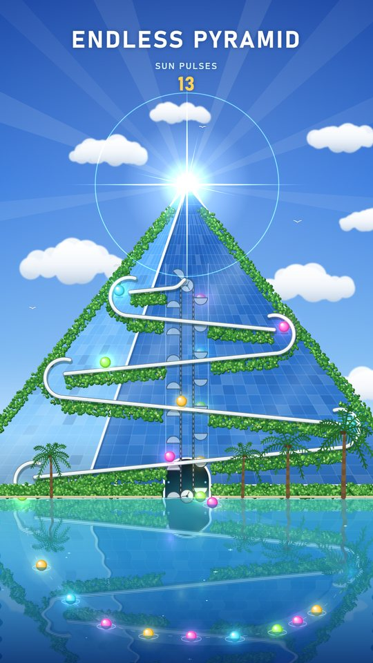
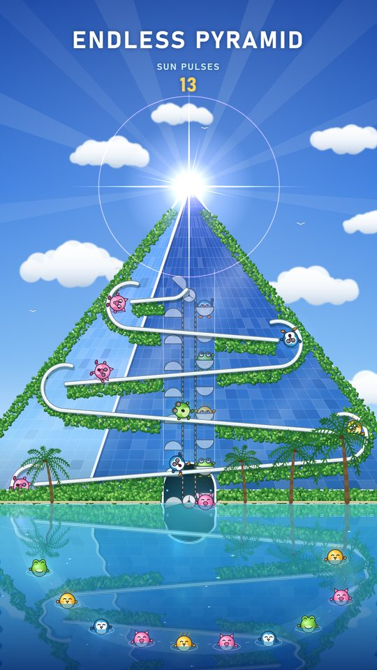
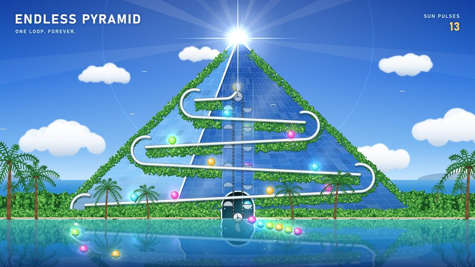
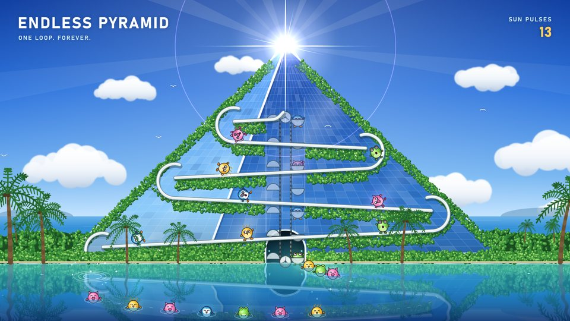
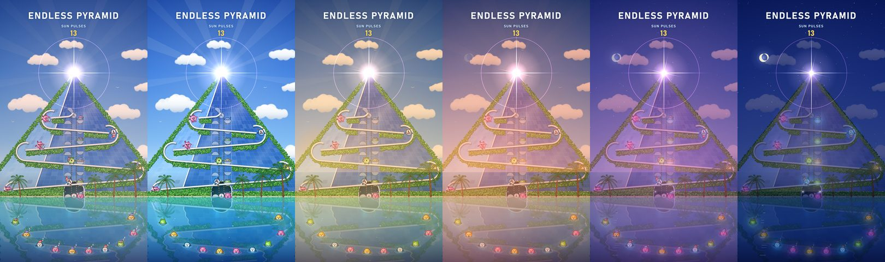
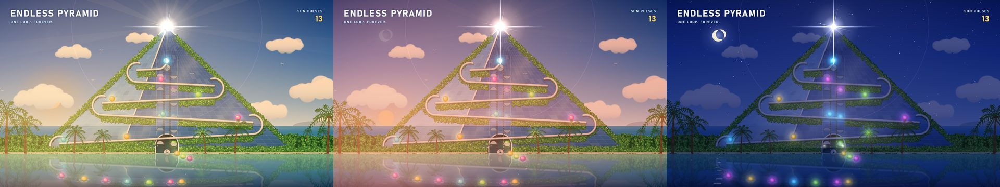

# Endless Pyramid – viertes Szenario (13.11.2026)

Branch `endless-pyramid`, isoliert in einem eigenen Worktree auf Basis von `main` (`247992a`) entwickelt.
Ausgangspunkt war ein freigegebener Prototyp aus einer Kopie des Projekts (Leuchtkugeln, Murmelbahn mit
Becherwerk). Auftrag: einführen, testweise Tierchen statt Murmeln, Ton, alle Regler, Hoch- und Querformat.

| Leuchtkugeln hochkant | Tierchen hochkant |
|---|---|
|  |  |

| Leuchtkugeln quer | Tierchen quer |
|---|---|
|  |  |

Standbilder bei 20 s Simulationszeit, Seed 42, aus dem echten Renderer (`window.exportAPI.renderFrames`);
Tierchen hochkant mit Größe 22, quer mit Größe 18 (wie in den Vorlagen).

## Umfang

- `src/scenarios/pyramid.js` – Layout, Simulation, Renderer, Regler, Klangtabelle (eine Datei wie `marble.js`).
- `lib/audio.mjs` – vier neue erzeugte Klänge (`synth:chime`, `synth:boing`, `synth:wheee`, `synth:squeak`);
  vorhandene Klänge unverändert.
- `index.html` – eine `<script>`-Zeile.
- `presets/pyramid-portrait.json`, `pyramid-landscape.json`, `pyramid-tierchen-portrait.json`,
  `pyramid-tierchen-landscape.json` – je 20 s mit Ton.
- `test/pyramid.test.mjs` – 17 Fälle (siehe unten); in `core`, `config` und `marble` die fest aufgezählte
  Szenarioliste um `pyramid` ergänzt.
- README (Abschnitt „Endless Pyramid“), `assets/audio/README.md` (Klangnachweis), Changelog.

Seeschlacht, Kugelfabrik und Scrap Wars sind unverändert; ihre Golden-Referenzen bleiben gleich.

## Physik

- **Schienen** mit konstantem Gefälle, außen auf dem Glas. Das Gefälle wird so gewählt, dass die letzte Schiene
  knapp über dem Fuß endet. Fällt es unter 0,045 (große Figuren im Querformat), baut das Layout drei statt fünf
  Schienen; sonst gewönne die Rollreibung bei 0,6× Schwerkraft.
- **Wendekappen**: halbrunde Außenwand an jedem Schienenende; die Figur läuft an der Wand um und landet auf der
  nächsten Schiene. Am Ende lenkt eine Viertelkappe nach unten, dann freier Fall in die Lagune.
- **Rollen**: Beschleunigung 5/7 · g · Gefälle (Vollkugel), Rollreibung 12 E/s², Luftwiderstand 0,0008 · v²;
  im freien Fall volle Erdbeschleunigung. Stau-Logik: Mindestabstand 2 R + 6, keine Überlappung.
- **Becherwerk**: Band über zwei Rollen im Glasschacht; Becher schöpfen am unteren rechten Fußpunkt, der
  Lichtimpuls startet am Scheitel der oberen Rolle, die Figur verlässt den Becher kurz dahinter. Das Band hält,
  solange die erste Schiene noch belegt ist.
- **Lagune**: Strömung zum Tunnel im Pyramidenfuß; eine aufschlagende Figur schiebt schwimmende Figuren weiter,
  statt in der Luft zu warten. Die Länge reicht für 26 Figuren der Größe 24.
- **Drehung der Tierchen**: reine Darstellung, aber aus dem Weg berechnet (Rollen ohne Schlupf, Richtung nach der
  Auflage: Schiene unten, Kappe außen); im Fall richten sie sich auf.
- **Quadrat (1:1)**: zeigt die Querformat-Anlage verkleinert und mittig; die Physik ist mit 16:9 identisch.
- **Determinismus**: Simulation hängt nur von Seed und Physikreglern ab. Darstellungsregler, Auflösung,
  Bildrate und Rendering verändern den Zustands-Hash nicht (Test).

## Regler

Tempo (wirken sofort): Gesamttempo 0,25–1,5× (Zeitlupe für alles), Tempo des Becherwerks 0,25–2×,
Rolltempo auf der Bahn 0,25–1,6× (Zeitlupe nur für die Bahn), Strömung 0,25–2×.
Neustart: Anzahl 12–26, Größe 24–48 px. Darstellung (live): Figuren, Leuchten, Lichtimpuls, Sonnenstrahlen,
Wolkentempo, Spiegelung, Wellengang, Glitzern, Gezappel, Vögel, Strömungsspur. Dazu je Klang ein
Lautstärkeregler (acht Klänge).

## Prüfung

| Prüfung | Ergebnis |
|---|---|
| `test/pyramid.test.mjs` (17 Fälle: Kreislauf beide Formate, Determinismus, Darstellung ohne Einfluss, 7 Konfigurationen inkl. 1:1 und Zeitlupe, Normalisierung, Ton beider Darstellungen, Oberfläche, MP4 mit Ton, Gesamttempo) | 17/17 bestanden (auch nach den letzten Änderungen erneut) |
| Gesamte Suite `npm test` | 129/129 bestanden, 13 min, inklusive unveränderter Golden-Referenzen (Seeschlacht, Kugelfabrik) |
| Belastungstest 34 Kombinationen (Größe 12–24 × Anzahl 12/26 × drei Formate, Reglerextreme, Tierchen), je 5 Minuten | alle Prüfungen fehlerfrei; einzig 0,4× Strömung im Querformat liefert in einzelnen Minuten nur 7 Lichtimpulse (lange Treibzeit, kein Stau) |
| 12-s-Export Tierchen hochkant (`pyramid-tierchen-portrait.json`, `--duration 12`) | Exportprüfung OK; 78 Tonereignisse, −14 LUFS, Spitze −2,6 dBFS |

## Nachtrag: Tempo

Auf Wunsch lässt sich alles langsamer laufen lassen. Neuer Regler „Gesamttempo“ (0,25–1,5×) als Zeitlupe für
Physik und Animationen; Einzeltempi bis 0,25×. Das Rolltempo wirkt nicht mehr über die Schwerkraft, sondern als
Zeitlupe nur für die Bahn – bei niedriger Schwerkraft konnte die Rollreibung sonst gewinnen. Bei Standardreglern
ist der Ablauf unverändert. Test: halbes Gesamttempo ergibt denselben Ablauf in doppelter Videozeit
(Lichtimpulse ±2 wegen des feineren Zeitschritts); alle Tempi auf 0,25× laufen ohne Stillstand.

Weiterer Ausbau für längere Videos: [ROADMAP R23](ROADMAP.md); Melodie als Merkposten R24.

## Nachtrag: Tageslauf (R23 P2)

Auf ausdrücklichen Wunsch ohne vorgeschaltete Vorschau (P1) direkt eingebaut.

Hochkant (Tierchen): Morgen, Tag, goldene Stunde, Sonnenuntergang, Dämmerung, Nacht. Quer (Leuchtkugeln): goldene
Stunde, Sonnenuntergang, Nacht. Tageszeit aus der Videozeit (60 Schritte je Videosekunde), daher unabhängig von
Gesamttempo und Filmtempo. Einfärben per Multiplikation und warmem Licht; Lichter werden danach gezeichnet.
Tests: Nacht < 60 % der Mittagshelligkeit, neuer Morgen nach Tagesende, Zustands-Hash mit und ohne Tageslauf gleich
(beide Formate, beide Darstellungen); 19/19 Pyramiden-Tests bestanden. Hör-/Sichtprobe im laufenden Clip offen.

## Offen

- **Hörabnahme** der vier neuen Klänge und der Mischung (bisher nur technisch geprüft).
- **Filmabnahme** längerer Exporte; der Ausschnitts-Export (`--clip-start`) ist für dieses Szenario wie bei
  Naval/Marble nicht freigegeben.
- Tierchen wurden bewusst „testweise“ eingebaut; Standard bleibt „Leuchtkugeln“. Ärmchen und Beinchen nach
  Rückmeldung gekürzt.
