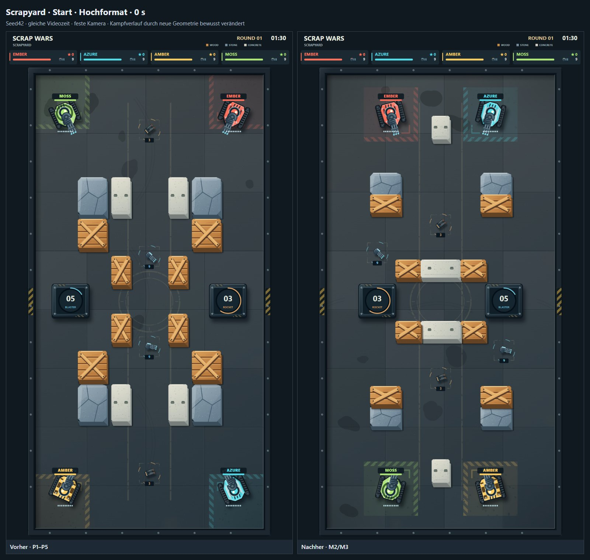
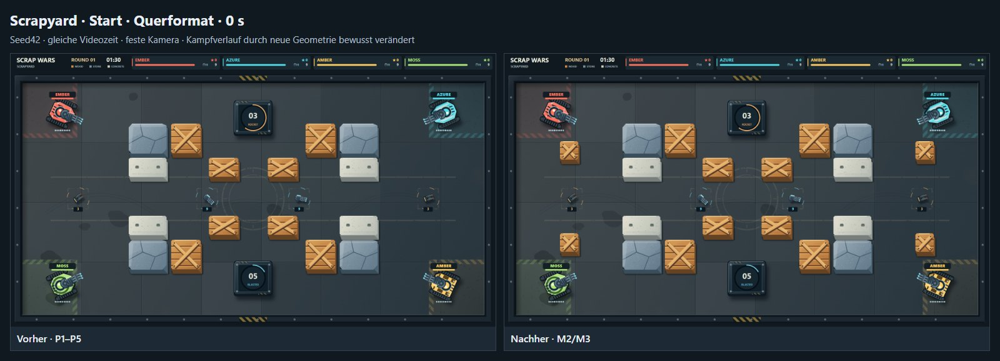
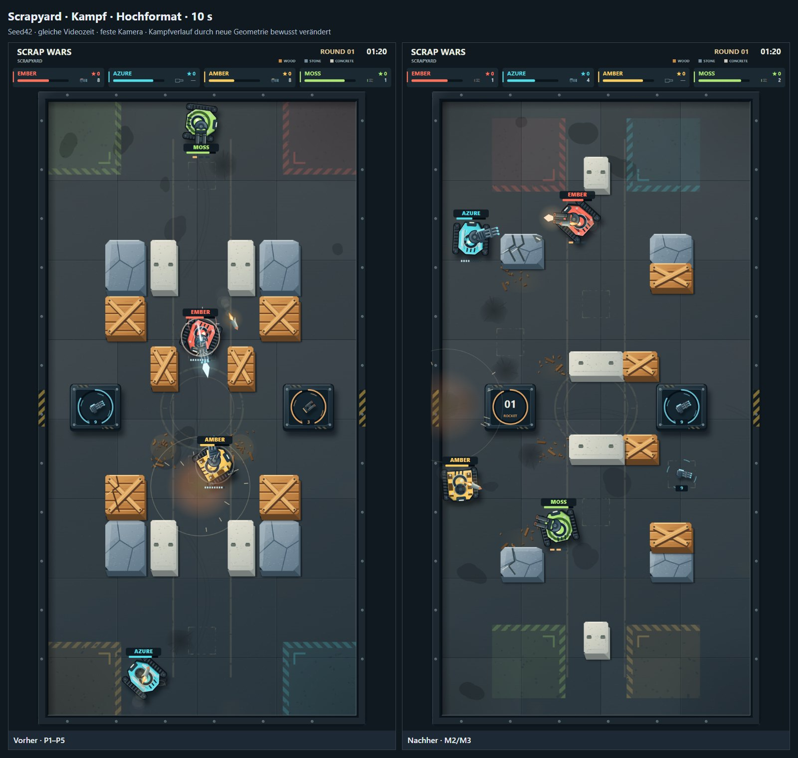

# Scrapyard: eigener Hochformat-Grundriss und zusätzliche Deckung

Stand: 15.11.2026. Umsetzung nach Nutzerfreigabe auf `codex/scrap-optik`,
Basis `2fd7a99` mit abgeschlossenen Optikpaketen P1–P5. Kein Merge in `main`.
M3: `3655ae6`; M2: `b056906`. Eine eigene Schrift (P6) ist nicht vorgesehen.

## Was sich ändert

- **Hochformat (M3):** eigener Grundriss über die gesamte Arenahöhe. Zwei Starts im
  Norden, zwei im Süden; acht gespiegelte Deckungsgruppen aus insgesamt 16 Blöcken.
  Der Materialbestand bleibt bei acht Holz-, vier Stein- und vier Betonblöcken.
  Waffen, Stationen, Startfelder und Bodenmarkierungen folgen dem neuen Grundriss.
- **Querformat (M2):** vier zusätzliche, gespiegelte Holzkisten (je 40 × 40 AE) in
  den freien Außenbereichen. Die vorhandenen Starts und Nachschubpositionen bleiben.
- Zwischen neuen getrennten Deckungsgruppen und Außenwänden liegen mindestens
  **96 Arena-Einheiten**; Start- und Nachschubpunkte halten mindestens 40 AE Abstand.
  Berührende Blöcke im Hochformat bilden bewusst eine zusammenhängende Deckungsgruppe.
  Die bisherigen kleinen Abstände innerhalb alter Querformat-Cluster sind keine neuen Durchgänge.

Foundry bleibt wegen seiner bereits schmaleren Außenwege unverändert. Crossroads
behält sein offenes Kreuz. Sunny Yard, Original-/V2-Regeln, Physik, KI, Materialwerte
und die feste Kamera sind unverändert. Änderungen an diesen Karten wären eigene
Entwurfsaufgaben; für diesen Ausbau ist dort kein weiteres Paket nötig.

## Vorher / nachher

Echte Exportbilder mit Seed 42, V3, HUD an, fester Kamera und identischen Zeitpunkten.
Links vorher, rechts nachher. Neue Geometrie verändert auch die Bewegung und Treffer;
die Kampfbilder zeigen deshalb bewusst verschiedene Verläufe desselben Seeds.

[Weiterer Kampfvergleich nach 20 Sekunden](reference/scrap-m2-m3-c-yard-portrait-20s.jpg).

## Beobachteter Rundenverlauf

Erste Runde bei Tempo 1, ohne Werkstatt. Vorher verwendeten beide Formate dieselbe
Geometrie. Sieger: Ember, Azure, Amber, Moss.

| Format / Seed | Dauer vorher → nachher | Größte Feuerpause | Längste Waffensuche | Sieger vorher → nachher |
|---|---:|---:|---:|---|
| Quer / 42 | 24,81 → 41,69 s | 1,33 → 1,46 s | 5,72 → 6,70 s | Azure → Ember |
| Quer / 7 | 46,93 → 35,28 s | 2,06 → 1,46 s | 29,57 → 6,97 s | Ember → Moss |
| Quer / 314 | 46,96 → 39,78 s | 2,19 → 1,46 s | 12,03 → 3,75 s | Ember → Ember |
| Hoch / 42 | 24,81 → 36,95 s | 1,33 → 1,21 s | 5,72 → 6,82 s | Azure → Amber |
| Hoch / 7 | 46,93 → 29,82 s | 2,06 → 0,73 s | 29,57 → 3,40 s | Ember → Azure |
| Hoch / 314 | 46,96 → 36,97 s | 2,19 → 2,18 s | 12,03 → 5,97 s | Ember → Moss |

Alle sechs Runden enden regulär. Die längsten Suchphasen werden bei Seeds 7 und 314
kürzer; Seed 42 dauert länger und enthält etwas mehr unbewaffnete Zeit. Die drei
Seeds belegen keine allgemeine Balanceverbesserung. Der Bewegungsindikator
(unter 4 AE zurückgelegter Weg in einem gleitenden 1-s-Fenster) meldet keine
Auffälligkeit; das ist kein allgemeiner Beweis gegen Festfahren.

**Wiederholbarkeit:** Neue und gespeicherte V3-Scrapyard-Konfigurationen nutzen ab
diesem Stand die neue Geometrie. Alte Filme aus `2fd7a99` lassen sich mit demselben
JSON auf diesem Stand deshalb nicht bildgleich wiederholen. Für solche Wiederholungen
ist der damalige Code-Stand erforderlich. Innerhalb des neuen Stands bleiben Seed,
Tempo, Turnierplanung und Export wiederholbar; ein Formatwechsel wählt einen anderen Grundriss.

## Prüfungen und Grenzen

- Vollvergleich von **60 Fällen**: vier V3-Karten sowie Original/V2 auf ihren drei
  Karten, jeweils zwei Formate und Seeds 42/7/314. Nur die sechs V3-Scrapyard-Fälle
  ändern sich; die übrigen **54** behalten vollständigen Zustand und Ereignisse exakt.
  Keine Invariantenverletzungen.
- Begehbarkeit und freie Start-/Nachschubpunkte auf allen Karten geprüft;
  Hochformat-Scrapyard verbindet alle 3007 begehbaren Zellen des 10-AE-Prüfrasters.
- Die gemeinsame Golden-Prüfung bleibt unverändert: **36 Fälle × zwei Prüfpunkte**.
  Diese Fixture enthält Naval/Marble/Mycelium, nicht Scrap; sie wird für M2/M3
  ausdrücklich nicht neu geschrieben. Separate Scrap-Referenzen prüfen beide neuen
  Grundrisse mit drei Seeds bei 0/10/40/120 s einschließlich Folgerunden.
- Die archivierten Quellen `simulation.js`, `renderer.js` und
  `scrap-arena.source.html` bleiben bytegleich.
- Zehn Nachher-Bilder mit identischen Einstellungen/Zeitpunkten geprüft.
  Crossroads und beide Sunny-Kontrollen sind PNG-exakt identisch. Foundry hat
  identische Zustands-/Ereignishashes; 230 von 2.073.600 Pixeln unterscheiden sich
  um jeweils eine Kanalstufe (0,0111 %, minimale Rasterabweichung ohne sichtbare Inhaltsänderung).

- `node scripts/test-ci.mjs export-scrap`: **2/2 bestanden**, reale 3-s-MP4s
  beider Produktionsvorlagen mit 1080p30, AAC-Ton sowie MP4-/JSON-Download.
  Diese Vorlagen verwenden weiterhin Sunny Yard.

Der vollständige Scrap-Lauf bestand zunächst **47/48** Tests. Der erweiterte Test
am tatsächlichen Rundenende deckte eine bereits in `2fd7a99` identisch reproduzierbare
Abweichung im Classic-Ergebnisbanner auf: Beim ersten Zeichnen nach einem Seek
unterschieden sich 43 Pixel des dünnen Farbbalkens; Simulation, Ereignisse und
Zeichenkontext waren gleich. Ein gefülltes Rechteck statt dieses einzelnen Strichs
beseitigt die Abweichung. Das Banner wird dafür im vorhandenen Adapter gezeichnet;
Layout und Schrift bleiben erhalten, die archivierte Quelldatei bleibt unverändert.
Der neue dynamische Bildtest prüft diesen Fall weiterhin exakt, ohne Pixeltoleranz.

Korrektur: `01510fb`. Abschließend **4/4 Optiktests im Software-Renderer**, der
**Classic-Clip-Test** mit Rundenwechsel/Abbruch und die **Quellintegritätsprüfung**
bestanden. Damit sind alle 48 Scrap-Prüfungen durch Gesamtlauf plus gezielte
Wiederholung abgedeckt; ein zweiter vollständiger Gesamtlauf wurde nicht durchgeführt.
Eine unabhängige Codeprüfung fand keine weiteren konkreten Fehler.

## Renderzeit

Messstand `b056906`, vor der ausschließlich Classic/V2 betreffenden Bannerkorrektur.
Hardware-Chromium, 1080p, Scrapyard quer, Seed 42, 30 Aufwärmbilder und anschließend
`renderFrames(300)` von 20 bis 30 s; jeweils drei frische Seiten. Während dieser
Messläufe liefen keine weiteren Projektprüfungen. Median der drei Messungen:

| Stand | Drei Läufe für 300 Bilder | Median pro Bild |
|---|---|---:|
| Vorher (`2fd7a99`) | 7483,3 / 8487,2 / 6845,3 ms | 24,944 ms |
| M2/M3 | 6964,6 / 6662,5 / 6956,8 ms | 23,189 ms |

Im aktuellen Vergleich **−7,0 %**, somit kein beobachteter Renderzeitaufschlag.
Der historische Wert vor P1 lag bei 20,968 ms; der jetzige Wert liegt rechnerisch
10,6 % darüber und damit innerhalb der geplanten 15 %. Die Ausgangsmessungen streuen,
und neue Geometrie verändert das Kampfgeschehen im Messfenster: Das ist ein
Praxisvergleich, keine isolierte Messung allein der Rendererkosten.

Lokale Rohbelege: `output/scrap-geometry/` mit unveränderlicher Baseline, Exportbildern,
Capture-Manifesten, Vorher-/Nachher-Audits und Testprotokollen. Die Rohbelege sind
bewusst keine Repository-Artefakte; die Vergleichsbilder und neue Zustandsfixture sind eingecheckt.
