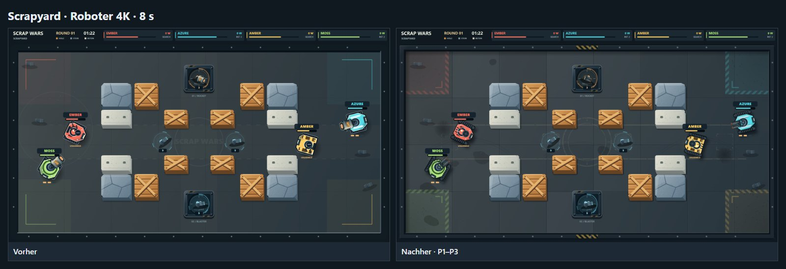
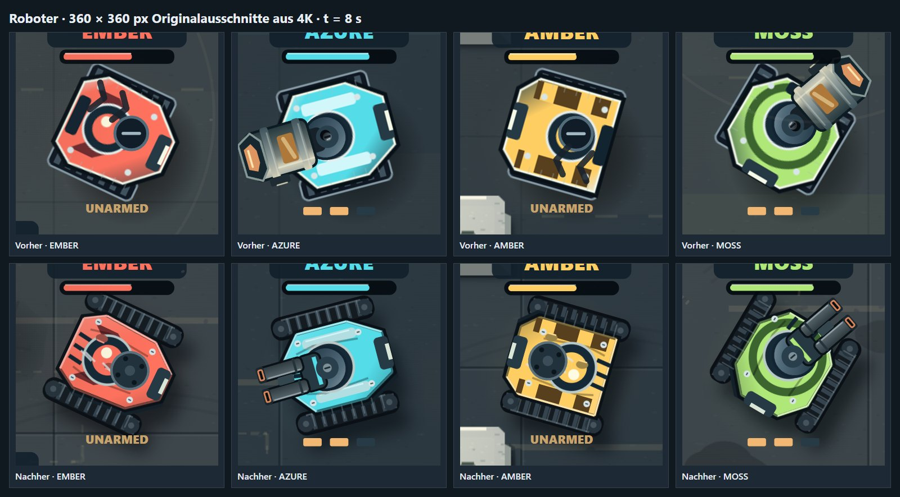
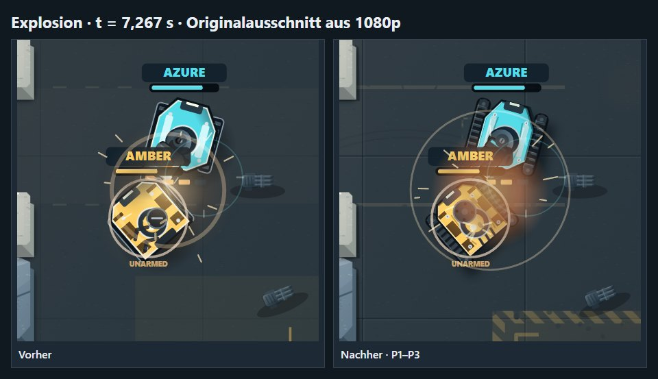

# Scrap Wars · Optik P1–P3

Umsetzung des [Optikplans](SCRAP_OPTIK_PLAN_2026-11-14.md) bis einschließlich P3,
auf Branch `codex/scrap-optik`, ausgehend von `09caa3d`.
Die visuelle Abnahme steht aus. P4–P6 und die Geometrieänderungen M2/M3 sind nicht umgesetzt.
Kein Push und kein PR.

## Änderungen

- **P1:** Explosionen mit Rauch, Feuerkern, Druckwelle und Funken; sichtbare Blasterbolzen,
  dichtere Raketenspur und KO-Splitter. Maximal 24 Brandflecken der aktuellen Runde,
  aus Ereignissen rekonstruiert. Auch der letzte KO blendet während der Ergebnispause ein.
- **P2:** Scrapyard mit Betonplatten, Foundry mit Stahl/Riffelblech und Crossroads mit Asphalt
  und Straßenmarkierungen. Abgewetzte Startfelder, Nachschubmarkierungen, schmale Stahlränder,
  Gebrauchsspuren und Kontaktschatten. Der Boden bleibt über Seeds und Folgerunden konstant.
  Die vorhandenen Start-, Stations- und Waffenpositionen werden gemeinsam aus `materials.js`
  gelesen; ihre Werte und die Kollisionsgeometrie bleiben unverändert.
- **P3:** 416-px-Körpertexturen, sichtbare Ketten, ruhigere Lackflächen und feste Schadensstufen.
  Montageplatte statt Verbotssymbol, kompakter Doppelrohr-Raketenwerfer, beschädigte Wracks
  und sechs Sekunden auslaufender KO-Rauch. Werkstattmodule bleiben an der Körperausrichtung
  befestigt. Der Blaster bleibt pixelgleich zur bisherigen Waffendarstellung.

Sunny Yard behält seinen Boden, seine Deckungs-, Stations- und Trümmergrafik; die gemeinsamen
Roboter und Effekte sind auch dort neu. Namen, Lebensanzeigen, Stationsbeschriftung,
Munitionsanzeigen und Siegerbanner behalten ihre bisherige Gestaltung bis P4/P5.

## Vorher / Nachher

Alle Aufnahmen zeigen Seed 42, V3, HUD an und feste Kamera. Beide Seiten verwenden dieselben
Einstellungen und denselben Simulationszeitpunkt. Quer-/Hochformatbilder sind 1080p,
die Roboterdetails stammen aus einer 4K-Aufnahme. Keine generierten oder nachgemalten Szenen.







| Vergleich | Bild |
|---|---|
| B · erster Raketeneinschlag, vollständiges Bild | [Öffnen](reference/scrap-optik-p1-p3-b-first-blast.jpg) |
| C · später Kampf, Schäden und Brandflecken | [Öffnen](reference/scrap-optik-p1-p3-c-late-combat.jpg) |
| D · Rundenende und Wracks | [Öffnen](reference/scrap-optik-p1-p3-d-round-end.jpg) |
| E · Scrapyard hochkant | [Öffnen](reference/scrap-optik-p1-p3-e-yard-portrait.jpg) |
| F · Foundry | [Öffnen](reference/scrap-optik-p1-p3-f-foundry.jpg) |
| F · Crossroads | [Öffnen](reference/scrap-optik-p1-p3-f-crossroads.jpg) |
| G · Sunny Yard quer | [Öffnen](reference/scrap-optik-p1-p3-g-sunny-landscape.jpg) |
| G · Sunny Yard hochkant | [Öffnen](reference/scrap-optik-p1-p3-g-sunny-portrait.jpg) |

Die erste Explosion tritt tatsächlich bei **7,175 s** auf; Bild B zeigt **7,2667 s**.
Das erste Rundenende liegt bei **24,8083 s**; Bild D zeigt **25,5 s**. Die leicht abweichenden
Zeitangaben im Plan wurden anhand der Ereignisse korrigiert. Bild C bei 50 s zeigt bereits
Runde 2, Rundenzeit 22,1833 s. Original-PNGs, Konfigurationen und Hashes liegen lokal unter
`output/scrap-optik/before/` und `output/scrap-optik/after/`.

## Prüfungen

- **36 Scrap-Prüfungen bestanden:** 18 Simulationstests, 11 Browserprüfungen,
  vier Optiktests und drei Robotertests. Im vollständigen Lauf war zunächst nur der
  unten beschriebene Bodenvergleich rot (32/33); nach dessen Korrektur wurde die
  gesamte Optikgruppe erfolgreich wiederholt (4/4). Die neuen Robotertests wurden
  separat mit Hardware- und Software-Rendering geprüft (je 3/3).
- **Zwei Produktionsprüfungen bestanden:** echte MP4-Exporte über die Oberfläche,
  jeweils 1080p, 30 fps, drei Sekunden / 90 Frames, mit Ton und JSON-Begleitdatei.
- **Golden-Prüfung:** 36 Konfigurationen mit je zwei Kontrollpunkten unverändert.
- **Neun Vorher-/Nachher-Konfigurationen:** alle Zustands- und Ereignishashes identisch.
  Die Seek-Prüfung vergleicht zusätzlich 18 Bilder exakt, darunter den Verlauf von
  Sekunde 20 bis 35 mit Rundenwechsel, Classic im Querformat, V2 im Hochformat sowie
  V3-Scrapyard und Sunny in beiden Ausrichtungen.

Die drei archivierten Dateien `src/scenarios/scrap/simulation.js`,
`src/scenarios/scrap/renderer.js` und `docs/reference/scrap-arena.source.html` sind
bytegleich zur Ausgangsbasis; ebenso `daylight-art.js`. Referenz-Hashes wurden nicht neu geschrieben.
Der reine Koordinaten-Refactor wurde zusätzlich in 24 Kombinationen aus vier Karten, zwei
Ausrichtungen und drei Seeds mit dem vollständigen bisherigen Zustand nach 90 s verglichen:
alle identisch.

Der Seek-Test liest jedes gezeichnete Bild aus, wie der echte Videoexport. Reines Zeichnen
ohne Auslesen lieferte bereits im Ausgangsstand kleine Canvas-Antialiasing-Unterschiede
(Hardware: zwei Pixel); der tatsächliche Exportpfad war mit Hardware und Software pixelgleich.
Es wurden keine Toleranzen eingeführt. Die neuen Tests vergleichen weiterhin exakt.

Der isolierte Bodenvergleich verwendet einen festen CPU-Rasterpfad: Chromium zeichnete
die feinen Foundry-Diagonalen nach dem Aufwärmen minimal anders, selbst bei zweimal Seed 42
(1.100 Pixel, höchstens zwei RGB-Stufen). Der Test stellt den ursprünglichen Canvas-Kontext
vor der Prüfung des echten Renderers wieder her. Produktionsrenderer, Seek- und Exporttests
verwenden weiterhin ihren normalen Pfad.

## Renderzeit

| Messung | Vorher | P1–P3 |
|---|---:|---:|
| Lauf 1, 300 Frames | 6.824,7 ms | 7.466,5 ms |
| Lauf 2, 300 Frames | 6.245,0 ms | 6.914,9 ms |
| Lauf 3, 300 Frames | 6.290,5 ms | 7.162,9 ms |
| Median pro Frame | 20,9683 ms | 23,8763 ms |

**Mehrzeit: 13,87 %.** Damit bleibt die Messung innerhalb der erlaubten 15 %;
der verbleibende Spielraum ist klein. Start- und Endzustand stimmen in allen Läufen
mit der Ausgangsbasis überein (`d3952a25` → `4795a9ad`). Die Quellen blieben während
der Aufnahmen und Messungen unverändert.

Gemessen wird `renderFrames(300)` mit 1080p, 30 fps, JPEG-Qualität 0,92 und AMD-Radeon-GPU,
jeweils von Videosekunde 20 bis 30 nach einer Sekunde gerendertem Vorlauf. Drei frische Seiten
pro Fassung; angegeben ist der Median. Der Vergleich schließt Simulation, Zeichnen und
JPEG-Erzeugung ein. Werte beschreiben diesen Rechner, keine allgemeine Exportgeschwindigkeit.

## Reproduktion und nächste Abnahme

```sh
node scripts/test-ci.mjs scrap
node scripts/test-ci.mjs export-scrap
npm run golden
node scripts/screenshot.mjs --scenario scrap --aspect 16:9 --params '{"rulesVersion":"v3","arena":"foundry"}' --at 1 --out output/foundry.png
```

Der lokale Belegordner enthält außerdem `capture.mjs` und `compare.mjs` für die exakten
Bildzeitpunkte und Vergleichsblätter. Die 3-Sekunden-Produktionsprüfungen sind technische
Exportproben, keine Abnahme eines vollständigen Langvideos.

**Nächster Schritt:** Vorher-/Nachher-Bilder durch den Nutzer abnehmen lassen. Erst danach
über P4/P5 entscheiden; eine Freigabe dafür oder zum Push ist bisher nicht erteilt.
