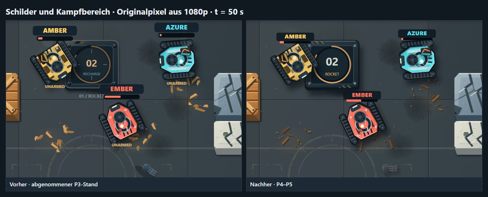
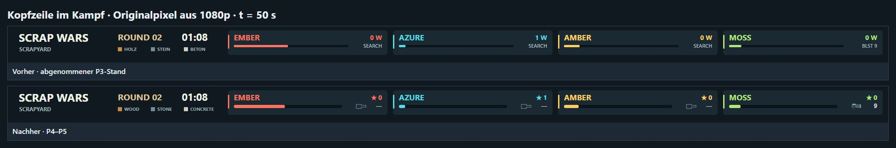
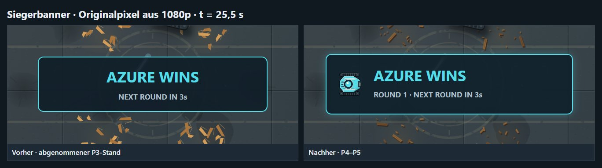

# Scrap Wars · Optik P4–P5

Abschluss: 15.11.2026. Umsetzung begonnen am 14.11.2026.

Fortsetzung des [Optikplans](SCRAP_OPTIK_PLAN_2026-11-14.md) nach der Abnahme von
[P1–P3](SCRAP_OPTIK_2026-11-14.md). Vorher ist der abgenommene Stand `e21496d`;
nachher zeigt zusätzlich P4 und P5 auf `codex/scrap-optik`. Alles bleibt lokal,
ohne Push oder PR. Die visuelle Abnahme dieser Fortsetzung steht aus.

## Änderungen

- **P4 · Spielfeld:** gemeinsame Schilder mit Namen und direkt anliegenden Lebensbalken,
  nach Robotern, Projektilen und Effekten gezeichnet. Sie weichen am oberen Rand und bei
  Überschneidungen nach unten aus; Wracks bekommen kein Schild. „UNARMED“ entfällt,
  Munitionspunkte sind auf 80 % verkleinert. Dies gilt auch für Classic, V2 und Sunny Yard.
- **P4 · dunkle V3-Karten:** Stationen zeigen die verbleibende Zeit und den Waffennamen,
  bei vorhandener Waffe nur den Fortschrittsring. Liegende Waffen werfen einen Schatten
  ihrer Silhouette; leere Waffen sind grau und verblassen ohne Zahl oder Glühen.
  Ruhigere Trümmerfarben und kleinere Splitter lassen geöffnete Wege besser erkennen.
  Stationshüllen, Waffensilhouetten und Trümmer werden begrenzt gecacht.
- **P5 · dunkle V3-Karten:** englische Materiallegende, Waffensymbole und Munition statt
  Abkürzungen, Siege mit Stern, kräftigere Lebensbalken und graue „KNOCKED OUT“-Karten.
  Rundenbanner mit Robotersymbol, Teamfarbe, Rundennummer und Countdown; eine kurze
  Einblendung wird direkt aus Ereignis-/Pausenzeiten berechnet. Das Turnierfinale bekommt
  dieselbe Gestaltung und behält seine Rangliste.

Sunny behält seine eigene Arena-, Stations-, Trümmer- und Waffengrafik sowie seine bisherige
Kopfzeile und Ergebnisanzeige. Auch die Kopfzeilen/Banner von Classic und V2 bleiben erhalten.
Blockgrafiken, Kameraverhalten, Kollisionen, Regeln und Simulation sind unverändert.
P6 und die Kartenumbauten M2/M3 sind nicht umgesetzt.

## Vorher / Nachher

Alle Vergleiche verwenden Seed 42, identische Einstellungen und denselben Videozeitpunkt,
HUD an und feste Kamera. Die neuen Details sind Ausschnitte echter Exportbilder.

| Weitere Vergleiche | Bild |
|---|---|
| A · Scrapyard bei 8 s, aus 4K | [Öffnen](reference/scrap-optik-p4-p5-a-yard-4k.jpg) |
| B · erster Raketeneinschlag | [Öffnen](reference/scrap-optik-p4-p5-b-first-blast.jpg) |
| C · später Kampf | [Öffnen](reference/scrap-optik-p4-p5-c-late-combat.jpg) |
| D · Rundenende | [Öffnen](reference/scrap-optik-p4-p5-d-round-end.jpg) |
| E · Scrapyard hochkant | [Öffnen](reference/scrap-optik-p4-p5-e-yard-portrait.jpg) |
| F · Foundry | [Öffnen](reference/scrap-optik-p4-p5-f-foundry.jpg) |
| F · Crossroads | [Öffnen](reference/scrap-optik-p4-p5-f-crossroads.jpg) |
| G · Sunny Yard quer | [Öffnen](reference/scrap-optik-p4-p5-g-sunny-landscape.jpg) |
| G · Sunny Yard hochkant | [Öffnen](reference/scrap-optik-p4-p5-g-sunny-portrait.jpg) |
| H · Rundenbanner hochkant | [Öffnen](reference/scrap-optik-p4-p5-h-yard-banner-portrait.jpg) |
| I · Turnierfinale quer | [Öffnen](reference/scrap-optik-p4-p5-i-tournament-landscape.jpg) |
| I · Turnierfinale hochkant | [Öffnen](reference/scrap-optik-p4-p5-i-tournament-portrait.jpg) |
| J · Sunny-Rundenbanner quer | [Öffnen](reference/scrap-optik-p4-p5-j-sunny-banner-landscape.jpg) |
| J · Sunny-Rundenbanner hochkant | [Öffnen](reference/scrap-optik-p4-p5-j-sunny-banner-portrait.jpg) |
| K · Kopfzeile nach Rundenende | [Öffnen](reference/scrap-optik-p4-p5-k-header-result.jpg) |
| L · belegte Station, Detail | [Öffnen](reference/scrap-optik-p4-p5-l-station-loaded.jpg) |
| L · nachladende Station, Detail | [Öffnen](reference/scrap-optik-p4-p5-l-station-recharging.jpg) |
| M · Trümmer und freie Wege, Detail | [Öffnen](reference/scrap-optik-p4-p5-m-rubble.jpg) |

Die Referenzen umfassen die neun Ansichten aus P1–P3 sowie ein zusätzliches Hochformat-
Rundenbanner, das Turnierfinale in beiden Ausrichtungen und Sunny-Rundenbanner in beiden
Ausrichtungen. Die Original-PNGs, Konfigurationen, Hashes und Hilfsskripte liegen lokal
unter `output/scrap-optik-p4-p5/`.

## Prüfungen

**Vollständige Scrap-Testreihe: 45/45 bestanden.** Darin enthalten sind elf Browserprüfungen,
18 Simulationstests und 16 gezielte Darstellungsprüfungen, einschließlich des exakten
Seek-Bildvergleichs über den Rundenwechsel. Keine ausgelassenen oder abgebrochenen Tests.

- P4 vor seinem Commit separat geprüft: zwölf Darstellungs-, Roboter- und Seek-Prüfungen bestanden.
- P5 separat mit GPU und Software-Rendering geprüft: je vier Prüfungen bestanden, einschließlich
  Einblendung, Seek, Unentschieden, Ende ohne Folgerunde und gemeinsamem Turniersieg.
- Zwei Produktionsprüfungen bestanden: echte MP4-Exporte über die Oberfläche,
  jeweils 1080p, 30 fps, drei Sekunden / 90 Frames, mit Ton und JSON-Begleitdatei.
- Golden-Prüfung: 36 Konfigurationen mit je zwei Kontrollpunkten unverändert.
- Alle 14 Vorher-/Nachher-Konfigurationen haben identische Zustands- und Ereignishashes.
  Alle 21 Vergleichsblätter sind visuell geprüft und bleiben unter 400 KB pro JPEG.

Die archivierte Simulation, der archivierte Renderer und die HTML-Quelle bleiben bytegleich
zu `09caa3d`; ebenso die Sunny-Art. Referenz-Hashes wurden nicht neu geschrieben. Alle neuen
Anzeigen lesen nur den vorhandenen Zustand. Schilder werden pro Bild neu platziert;
Banneralter und Ausblenden beruhen auf Simulations-/Videoticks, nicht auf Echtzeit oder
vorher gezeichneten Bildern.

## Renderzeit

| Messung | Vorher: abgenommener P3-Stand | Nachher: P1–P5 |
|---|---:|---:|
| Lauf 1, 300 Frames | 7.182,0 ms | 6.561,7 ms |
| Lauf 2, 300 Frames | 6.994,9 ms | 6.636,5 ms |
| Lauf 3, 300 Frames | 7.012,5 ms | 6.972,0 ms |
| Median pro Frame | 23,3750 ms | 22,1217 ms |

**P4/P5: 5,36 % weniger Renderzeit gegenüber P3.** Gegenüber dem ursprünglichen Stand
vor P1 (20,9683 ms/Frame) beträgt die gesamte Mehrzeit für P1–P5 **5,50 %** und bleibt
damit innerhalb der erlaubten 15 %. Start- und Endhash sind in allen Läufen identisch
(`d3952a25` → `4795a9ad`). Die Quellen blieben während der Messung unverändert;
alle Integritätsprüfungen bestanden.

Methode wie beim ersten Bericht: AMD-Radeon-GPU, 1080p, 30 fps, JPEG-Qualität 0,92,
`renderFrames(300)` von Sekunde 20 bis 30 nach einer Sekunde gerendertem Vorlauf.
Drei frische Seiten pro Fassung, Median einschließlich Simulation, Zeichnen und JPEG-Erzeugung.
Der neue Vorher-Lauf misst P3 im aktuellen Messfenster; zusätzlich wird die kumulative
15-%-Grenze gegenüber dem ursprünglichen Stand vor P1 geprüft.

## Stand

- P4: `0d431f3`, separat geprüft und lokal committed.
- P5: zusammen mit diesen Abnahmebelegen lokal committed.
- Nächster Schritt: visuelle Abnahme von P4/P5. Kein Push und kein PR freigegeben.
