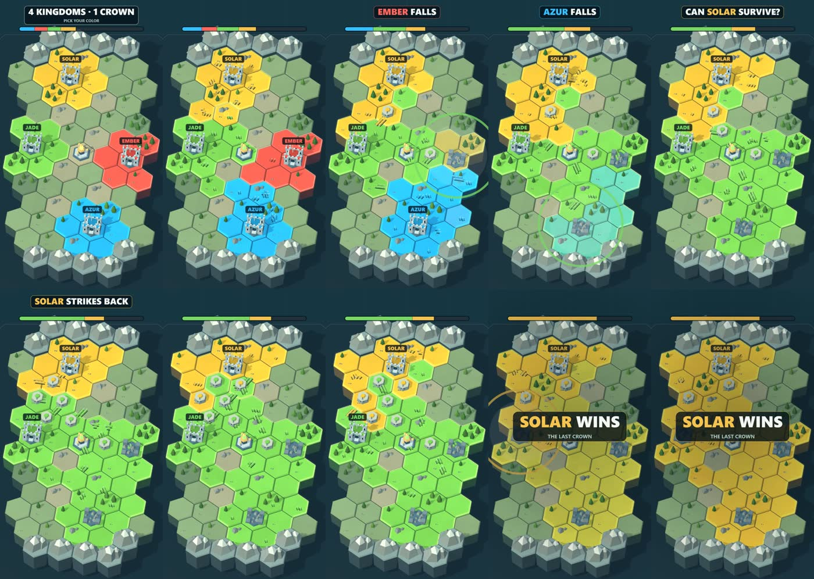

# Territory Wars · Short „Die letzte Krone“

Stand: 16.11.2026, Branch `feat/territory-short`. Auftrag: ein hochwertiges Short aus Territory Wars, ohne Rahmen,
mit Spannung und dezentem Ton. Grundlage sind die [Leitlinien für Shorts](SHORTS_LEITLINIEN.md).



## 1 · Warum ein eigener Modus

Die bisherige Short-Vorlage zeigte 60 Sekunden bei Tempo 0,75, also nur die ersten 45 Spielsekunden: Ausbreitung,
erster Kontakt, kein Ergebnis. Gemessen über zehn Seeds fällt die erste Burg auf der Originalkarte erst nach
1:31 bis 3:05 Minuten, ein Sieger steht nach 4 bis 13 Minuten fest. Das Finale allein taugt auch nicht: In 188
von 188 gemessenen Runden gewinnt, wer 52 Spielsekunden vor Schluss führt.

## 2 · Was neu ist

| Baustein | Inhalt |
|---|---|
| **Short-Karte** (`layout: short`) | Eigene kleine Karte mit rund 57 Feldern (Original hochkant: 143). Vier Burgen als Raute, Zitadelle in der Mitte, Berge nur als Kulisse oben und unten. Die Felder sind bei 1080 × 1920 etwa 170 statt 110 Pixel breit. |
| **Regelversion `territory-short-v1`** | Gilt nur auf der Short-Karte. Die archivierten Originalregeln in `simulation.js` bleiben Byte für Byte gleich; die Short-Runde ist eine abgeleitete Klasse in `short.js`. Neue Regel: Wer eine Burg nimmt, bekommt das ganze Reich. |
| **Drehbuch „Die letzte Krone“** | Eine verdeckte Regie verteilt aus dem Seed vier Rollen (Riese, Rivale, Beute, Außenseiter) und ändert nach festem Plan nur Faktoren: Nachschub, Tempo der Offensiven, Marschzeit und Verteidigung je Fraktion. Jede Einheit marschiert und kämpft weiter nach den Originalregeln. |
| **Profil „Blitz (Short)“** | Nachschub 2×, Offensivdrang 100 %, Angriffsrhythmus 2 s, Marschdauer 1,5 s, Filmtempo 2. Alle Werte liegen in den bisherigen Reglergrenzen. |
| **Anzeige** | Neuer Regler „Anzeige“: Automatisch, Voll, Schlank, Aus. Automatisch heißt hochkant schlank, quer voll. Schlank: kein Titel, keine Uhr, keine Fraktionskarten; die Karte füllt das Bild. Es bleiben ein Farbbalken, größere Namensschilder und kurze Einblendungen. Einblendung und Farbbalken liegen hochkant im freien Streifen über der Karte und verdecken kein Reich. |
| **Videoende** | Neuer Regler „Videoende: Nach dem Sieg“. Die Länge wird vor dem Export aus dem Verlauf berechnet: Sieg plus „Ergebnis zeigen“ (in der Vorlage 3 s). |
| **Ton** | Auf der Short-Karte die weichen Marble-Works-Klänge und drei weiche Syntheseklänge, fester Pegel ohne Lautheitsanhebung, dazu ein Tonplan, der nur wichtige Ereignisse hörbar macht. |
| **Seed-Suche** | `node scripts/territory-short-casting.mjs` zeigt, bei welchen Seeds die Höhepunkte am besten sitzen. Reine Simulation. |

### Ablauf des Drehbuchs (Seed 42, Videozeit)

| Zeit | Was passiert | Einblendung |
|---|---|---|
| 0 s | Vier gleich große Reiche, sofort Bewegung | 4 KINGDOMS · 1 CROWN / PICK YOUR COLOR |
| 9,7 s | Der Riese nimmt die Burg des Rivalen, dessen Reich wechselt die Farbe | EMBER FALLS |
| 15,3 s | Zweite Burg fällt, der Riese hält über die Hälfte der Karte | AZUR FALLS |
| 16,8 s | Der Riese wendet sich gegen den letzten Gegner | CAN SOLAR SURVIVE? |
| 19,7 s | Der Außenseiter schlägt zurück | SOLAR STRIKES BACK |
| 29,2 s | Die Burg des Riesen fällt, die ganze Karte färbt sich um | SOLAR WINS / THE LAST CROWN |
| 32,2 s | Ende | |

Die Regie öffnet jede Burg erst kurz vor ihrem Zeitpunkt und verstärkt den Druck, bis der Höhepunkt eintritt.
Die Burg des Außenseiters hält stand: Der Riese hält sie für einnehmbar und verliert dort seine Angriffe.

## 3 · Messwerte

| Messung | Ergebnis |
|---|---|
| Geschichte geht auf (Reihenfolge der Burgen, Sieger, gültige Bilanz) | 300 von 300 Seeds |
| Höhepunkte in Spielzeit, 80 Seeds, Plan 18,0 / 34,8 / 57,9 s | 19,0 ± 4,4 / 39,2 ± 6,4 / 61,5 ± 6,6 s |
| Videolänge der besten 14 von 300 Seeds | 30,4 bis 32,4 s |
| Seed 42 (Vorlage) | Platz 14 von 300; Riese bis 33 von 57 Feldern, Außenseiter bis auf 8 |
| Ton ganzes Short, Seed 42 | −24,3 LUFS, Spitze −7,7 dBFS, Begrenzer greift nicht ein, 80 Klänge in 32 s (2,5 je Sekunde) |
| Ton zum Vergleich, bisherige Mischung | −14 LUFS, rund 4 Klänge je Sekunde, Begrenzer bis −8 dB |
| Testclip 20 s, 1080 × 1920, 30 fps | 51 Klänge, −25,0 LUFS, Spitze −8,6 dBFS, Prüfung des Exporters bestanden |

## 4 · Nachweise

- `node --test test/territory-short.test.mjs`: 9 Tests. Regelversion nur auf der Short-Karte, gleicher Seed gleicher
  Krieg, Referenzverlauf Seed 42 (Fallzeiten, Sieger, Zustands-Hash), Geschichte und Invarianten für 40 Seeds,
  Originalregeln ohne Drehbuch, geplantes Videoende, Tonplan, Einblendungen, Einstellungen und Vorlage.
- `test/territory.test.mjs` (16) und `test/territory-audio.test.mjs` (3): unverändert bestanden, einschließlich
  der Vergleiche mit der archivierten Originalquelle.
- `test/territory-browser.test.mjs`: 6 Tests, einer neu (schlanke Anzeige hochkant, volle Anzeige quer, Short-Vorlage
  bis zum Sieg).
- Angepasst, weil sich die Short-Vorlage bewusst geändert hat: `test/presets.test.mjs` und der gemeinsame
  Vorlagen-Exporttest (Territory-Short hat jetzt Tempo 2 und ein geplantes Videoende).
- Bildprüfung: Vorschau-Bilder aus dem echten Renderer, oben verlinkt; dazu sechs Bilder aus dem exportierten Clip.

Nicht gelaufen: der vollständige `npm test` und die Prüfung der anderen Szenarien, da nur Territory-Dateien und die
Short-Vorlage geändert wurden.

## 5 · Grenzen

- **Kein ganzes Short exportiert.** Der Export über 20 Sekunden braucht einen ausdrücklichen Auftrag. Vorhanden sind
  ein 20-Sekunden-Clip mit Ton und Standbilder über die ganze Länge.
- **Hör- und Handyabnahme offen.** Lautheit und Dichte sind gemessen, nicht gehört. Ob Tempo 2 auf der kleinen
  Karte hektisch wirkt, zeigt erst der laufende Clip.
- **Die Regie ist eine Inszenierung.** Der Außenseiter gewinnt immer. Wer das nicht will, wählt „Ohne Drehbuch“;
  dann gelten auf der Short-Karte die Originalregeln.
- **Timing schwankt je Seed** um einige Spielsekunden. Die Seed-Suche findet die passenden.
- **Seek-Regel:** Die Einblendungen, der Farbbalken und die Namensschilder hängen nur von Rundenzustand und
  Videouhr ab. Die Farbübergänge der Karte behalten ihre bekannte Renderhistorie; der Ausschnittsexport bleibt
  deshalb gesperrt.
- **Bild nach dem Ergebnis läuft weiter.** Bisher blieb das Bild mit dem Ergebnis stehen; die letzte Eroberung
  färbte die Karte nie um. Jetzt laufen Farbwechsel, Fahnen und Effekte in Videozeit zu Ende. Das gilt für alle
  drei Karten und ändert nur die Darstellung.

## 6 · Bedienung

```bash
node scripts/territory-short-casting.mjs --from 1 --to 300 --top 14
```

```bash
node export.mjs --config presets/production/territory-short.json --param videoEnd=free --duration 20 --out output/probe.mp4
```

Im Simulator: Szenario Territory Wars, Knopf „Short-Vorlage“. Die Videolänge wird automatisch berechnet.
