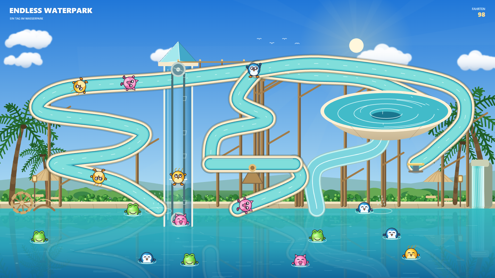
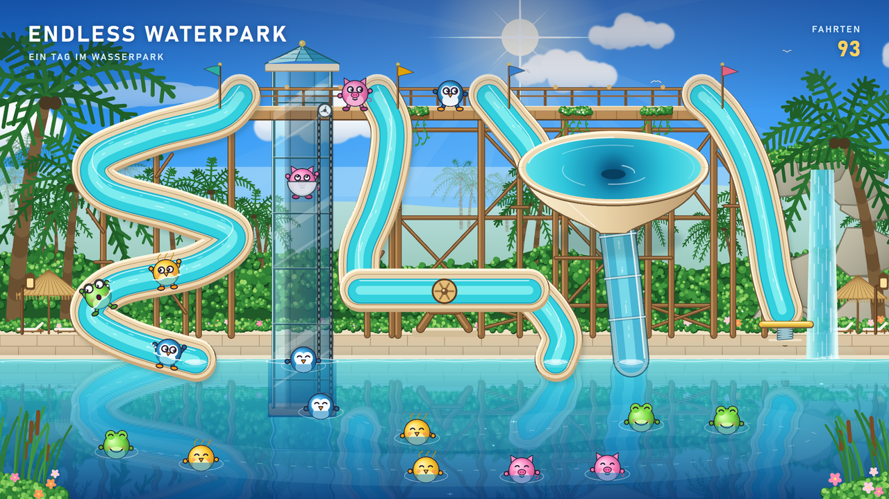
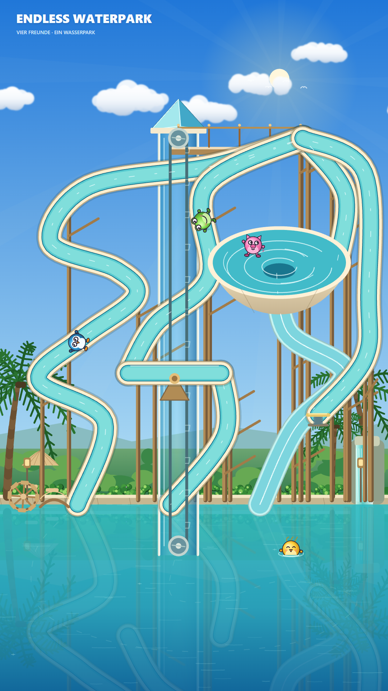
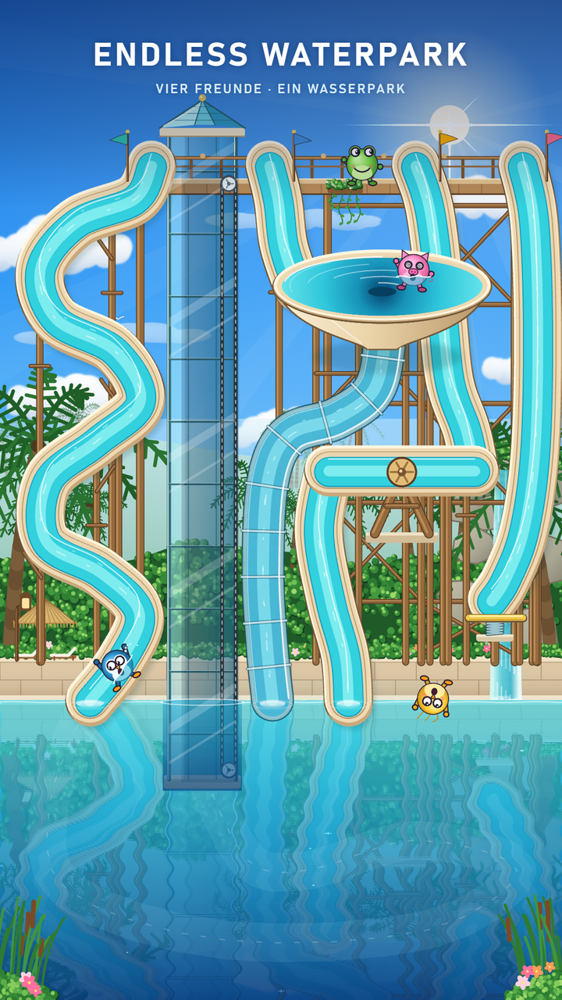

# Endless Waterpark – Optik nach Mockup und Pyramide (16. November 2026)

**Auftrag:** Das neue Wasserpark-Szenario sah deutlich einfacher aus als das
[Mockup](nachweise/waterpark_mockup_16x9_2026-11-16.png). Ziel war, dass es wie das Mockup aussieht,
die Tiere wie in den Pyramiden-Szenarien und die Grundoptik ebenfalls wie die Pyramide. Der Nutzer
hat die direkte Umsetzung beauftragt („Du kannst es gern direkt umsetzen“).

Arbeitsbranch `codex/waterpark-optik` auf Basis `d84cf43`. Nicht gepusht, kein PR.

## Vorher und nachher

| Vorher | Nachher |
|---|---|
|  |  |
|  |  |

Weitere Bilder aus dem laufenden Szenario:
[Abend mit „Die letzte Runde“](nachweise/waterpark_optik_abend_16x9_2026-11-16.png) ·
[Fontänenshow und Feuerwerk](nachweise/waterpark_optik_finale_16x9_2026-11-16.png)

## Was sich geändert hat

**Grundriss wie im Mockup.** Gläserner Liftturm mit Dach links der Mitte, darüber ein
durchgehendes Holzdeck mit Geländer und Wimpeln. Von dort gehen alle vier Attraktionen ab:
Panoramarutsche in Schlangenlinien, Trichter mit Glasrohr, Wippe und Sprungbrett. Jede Rutsche
endet in einer eigenen Bucht der Lagune. Hoch- und Querformat haben je einen eigenen Grundriss.

**Tiere wie in der Pyramide.** Es sind dieselben gemeinsamen Tierchen-Grafiken (`EBS.CritterArt`).
Neu ist, dass die Posen zur Situation passen:
- Auf dem Deck laufen sie.
- Auf flachen Rutschen sitzen sie mit Bugwelle.
- Auf steilen Rutschen reißen sie die Arme hoch.
- Im Trichter haben sie Spiralaugen.
- Im Lift sitzen sie im Becher.
- In der Lagune schwimmen sie wie in der Pyramiden-Lagune.
- Nachts tragen sie Schlafmützen.

**Licht und Himmel wie in der Pyramide.** Übernommen wurden:
- Tageszeiten-Verläufe, Sonnenstrahlen, Schleierwolken
- Farbstimmung über Multiplizieren/Aufhellen
- selbstleuchtende Lampen, Sterne, Mond mit Lichthof und Glitzern auf dem Wasser
- Spiegelung in der Lagune
- Himmelsgäste (Ballon, Vögel, UFO, Sternschnuppen), Fische und Sprechblasen

**Kulisse.** Hügel, Dschungelband, Felsen mit Wasserfall und große Rahmenpalmen. Dazu kommen
Holzgerüst mit Streben, Strohschirme, Laternen, Hibiskus, Schilf und eine Lichterkette am Deck.

**Rutschen und Wasser.** Die Rinnen haben eine helle Kante, eine türkise Wasserrinne und einen
Wasserfilm, der in Fahrtrichtung fließt. Das Glasrohr am Trichter hat Ringfugen und Glanzlinien.
Der Trichter hat einen Strudel. Geschlossene Rutschen sind trocken und mit einer Schranke gesperrt.

**Wippe mit Übergaben (Nachtrag nach Nutzerhinweis).** Vorher lief die Zulaufrinne mit einem Haken
hinter das Brett, und die Abflussrinne kam schräg hinter dem Brettende hervor. Jetzt gilt:
- Die Zulaufrinne endet als Ausguss über dem Einstiegsende. Das Tier plumpst mit einem kleinen
  Wasserstrahl auf das Brett.
- Am anderen Ende gießt das Brett in eine kurze Auffangrinne, wie im Mockup.
- Die Abstände ergeben sich aus Rinnenbreite und größter Neigung, deshalb überdecken sich die Teile
  auch beim Kippen nicht.
- Im Querformat sitzt die Wippe dafür etwas höher.

[Bild](nachweise/waterpark_optik_wippe_16x9_2026-11-16.png)

**Anzeige.** Pyramiden-Stil (Bahnschrift, Sperrung, dunkler Verlauf oben). Das Abschlussbanner
steht im Querformat frei zwischen Titel und Mond, im Hochformat ersetzt es die Unterzeile.

**Finale.** Die Fontänen sind jetzt farbig beleuchtet: Mittelstrahl, drei Bögen je Seite,
Tropfen und Lichtfleck auf dem Wasser. Das Feuerwerk hat zwei Ringe mit Funkenschweifen.

**Größe.** Die Tiere sind größer: Standard 28 statt 24, im Short 30. Das gilt in der Oberfläche,
in allen acht Wasserpark-Vorlagen und im Produktionsgenerator.

## Was das für den Ablauf bedeutet

Die Darstellung ändert die Simulation nicht. Der neue Grundriss legt aber andere Wege fest, deshalb
verlaufen die Filme anders als in der ersten Fassung (andere Zustands-Hashes bei gleichem Seed).
Zwei kleine Änderungen in der Simulation:
- Im Short warten die vier Freunde zu Beginn im Becherwerk und steigen oben einzeln aus.
- Die Wippe kann im Hochformat nach links kippen (`dir`).

Die Pyramide und die gemeinsame Tiergrafik (`pyramid.js`, `critter-art.js`) sind unverändert.

## Technik

- `src/scenarios/waterpark/art.js` (neu): statische Zeichnungen, also Himmel, Kulisse, Gerüst,
  Deck, Turm, Rinnen, Glasrohr, Trichter, Wippe, Sprungbrett und Vordergrund. Sie werden einmal in
  Ebenen gezeichnet.
- `src/scenarios/waterpark/renderer.js` (neu geschrieben): Bildaufbau pro Frame mit
  zwischengespeicherten Ebenen, Tieren, Wasserfilmen, Licht, Nacht, Gästen, Finale und Anzeige.
- `src/scenarios/waterpark/layout.js`: Grundrisse je Format als Anteile von Breite und Höhe.
- Zeichenzeit bei 1080p: etwa 1,1 ms pro Bild am Tag, 2,2 ms im Finale. Zum Vergleich: Pyramide
  etwa 1,6 ms.

## Prüfungen

- **54/54 Tests** (Windows): Wasserpark-Simulation (17), -Integration (7) und -Browser,
  gemeinsame Tiergrafik sowie Pyramide und Pyramiden-Short.
- **Golden-Hashes** (36 Fälle × 2 Prüfpunkte): identisch mit der Referenz.
- **`scripts/waterpark-review.mjs`:** fünf Aufnahmen (Tag und Abend quer; Short bei 8, 22 und
  29 s hoch) mit Zustandsprüfung, dazu ein Bewegungs- und Paritätscheck über 60 Bilder.
  Die Pyramide zeigt dort nur dieselben kleinen Abweichungen, die auch zwischen zwei Läufen der
  Ausgangsfassung auftreten.
- Sichtprüfung im Rendering: Morgen mit noch geschlossenen Rutschen, Tag, Abend, Nacht, Finale mit
  Fontänen und Feuerwerk, Short-Ende, jeweils in beiden Formaten.
- Der vollständige Testlauf (`npm test`, etwa 38 Minuten) wurde nicht wiederholt.

## Offen

- **Sprache der Anzeige:** Die Texte bleiben deutsch („Fahrten“, „Gute Nacht, kleine Freunde“).
  Die Pyramide zeigt englische Texte. Bei Wunsch lässt sich das angleichen.
- Die persönliche Sicht- und Hörabnahme auf PC und Handy bleibt bei R30.
