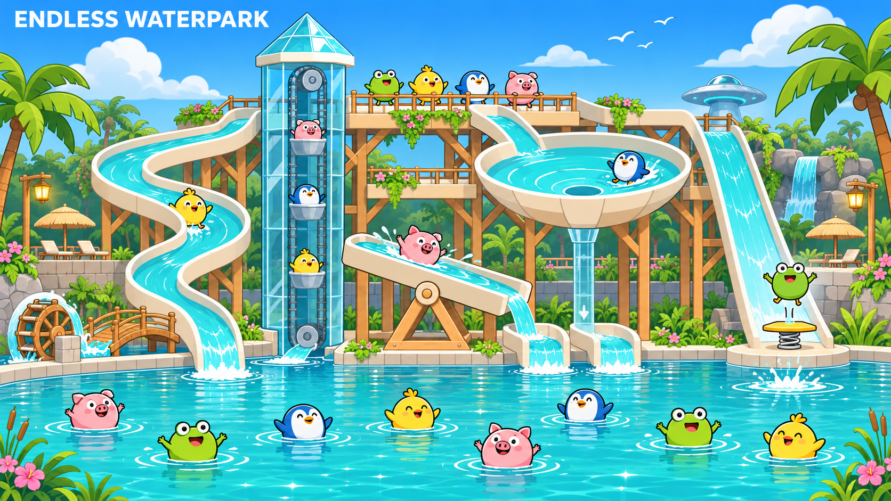

# Plan für das Wasserpark Szenario

**Plan vom 15.11.2026 · Projekt: SimCascade · Roadmap: R30.** Die Umsetzung wurde am
16.11.2026 ausdrücklich beauftragt („Ja setze den Plan um“). Das eigene Wasserpark-Szenario für
Shorts und Langvideos orientiert sich optisch an Endless Pyramid, einschließlich Himmel, UFO
und weiterer Dekoration. Den tatsächlich implementierten und geprüften Stand dokumentiert der
[Umsetzungsbericht](WASSERPARK_UMSETZUNG_2026-11-16.md). Vollständige Filmproduktionen bleiben
separate Aufträge; während der Entwicklung entstehen nur kurze Proben bis 20 Sekunden.

## 1 Zielbild und Umfang

**Arbeitstitel: Endless Waterpark.** Ein sonniger Oasen-Wasserpark mit einem gläsernen Aufzugturm,
vier verschiedenen Rutschwegen und einer großen türkisfarbenen Lagune. Küken, Pinguin,
Schweinchen und Frosch fahren nach oben, nehmen wechselnde Attraktionen und schwimmen durch
einen sichtbaren Wasserlauf zurück. Die Anlage ist als zusammenhängender Kreislauf verständlich.

Die erste vollständige Version umfasst alle vier Routen, Hoch- und Querformat, Tageslauf,
Himmelsgäste, dekorierte Ufer, passende Geräusche und drei Videoabläufe. Entwickelt wird zuerst
ein vollständiger kleiner Kreislauf, auf den die weiteren Attraktionen aufbauen.

| Bestandteil | Festlegung für die erste vollständige Version |
|---|---|
| Figuren | Die vier vorhandenen Tierarten mit gleicher Grundgröße und denselben Bewegungsmöglichkeiten. Individuelle Mimik und Gestik bleiben erhalten. |
| Attraktionen | Panoramarutsche, Trichterrutsche, Wippenbahn und Sprungrutsche. Jede Route ist einzeln schaltbar. |
| Betrieb | Sichtbarer Aufzug, Startplattform mit Verteiler, getrennte Einmündungen ins Becken und gemeinsamer Rücklauf. |
| Videoabläufe | Kurzer Vier-Tiere-Film, Parktag mit Entwicklung und Abschluss, ruhiger Dauerbetrieb. |
| Bild | Eigenes Layout für 9:16 und 16:9, feste gut lesbare Gesamtansicht als Standard. |
| Atmosphäre | Wolken, Sonne, Vögel, Ballon, UFO, Sterne, Mond, Sternschnuppen, Tag-Nacht-Wechsel, Wasser und Pflanzen. |
| Ton | Durchgehender ruhiger Wasserhintergrund, leise Aktionsklänge, getrennte Lautstärken. Standard ohne Musik und gesprochene Erzählung. |
| Abschluss | Gemeinsames Sammeln im Becken, Abendbeleuchtung und wahlweise ruhiger Schluss oder kleine Fontänenshow mit optionalem Feuerwerk. |

Rennen, Olympiade, Waschstraße und die anderen Ideen aus [R29](TIERCHEN_VIDEOIDEEN_2026-11-15.md)
bleiben eigenständige spätere Erweiterungen. Die Wippe und das Sprungbrett gehören bereits zum
Wasserpark; eine Punktewertung oder ein behaupteter Sieger gehören nicht zum normalen Parkbetrieb.

## 2 Gestaltung im Stil der Pyramide

### Designmockup vom 16. November 2026

Auf Nutzerwunsch mit Imagegen erstellte 16:9-Ansicht zur Beurteilung von Optik und Bildaufteilung.
Das Bild ist ein Gestaltungsvorschlag, keine Aufnahme eines implementierten Szenarios; Fahrwege
und Anschlüsse werden bei der Umsetzung anhand des Plans konstruiert und geprüft.
Der [verwendete Prompt](nachweise/waterpark_mockup_16x9_2026-11-16.prompt.txt) ist mitgespeichert.

### Gemeinsame Bildsprache

Referenzen sind die [Lagunenansicht](nachweise/pyramid_tierchen_16x9.jpg) und die aktuelle
Wüstenvariante im [Pyramiden-Szenario](../src/scenarios/pyramid.js). Der Wasserpark übernimmt
die weichen Farbverläufe, plastischen runden Tiere, klaren Konturen, leuchtenden Wasserkanten,
natürlichen Ufer und den langsamen Wechsel von blauem Tageslicht zu warmem Abendlicht.

Der zentrale Turm bekommt transparente Glasflächen, helle Träger und ein kleines gläsernes
Pyramidendach als optische Verbindung. Die Tiere im Lift bleiben sichtbar. Rutschen erhalten
abgerundete helle Ränder, einen erkennbaren Wasserfilm und dezente türkisfarbene Schatten.
Holzstege, sandfarbene Sockel, Palmen und bepflanzte Geländer verbinden den Park mit der Lagune.

| Gestaltung | Vorgabe |
|---|---|
| Farben | Himmel in Blau/Azur, Wasser in Türkis, helle cremefarbene Rutschenränder, warmes Holz und natürliche Grüntöne. Die Tierfarben bleiben Gelb, Blau, Rosa und Grün. |
| Licht | Zusammenhängende Lichtstimmung über Himmel, Bauwerk, Wasser und Pflanzen; abends warme Leuchten. Tiere behalten auch nachts Farbe und gut erkennbare Gesichter. |
| Konturen | Ähnliche dunkle, weiche Außenkonturen wie bei den vorhandenen Tieren. Glas bekommt schmale Glanzkanten; Gesichter werden nicht von Spiegelungen überstrahlt. |
| Tiefe | Gestaffelte Rutschen, sichtbare Stützen, Schatten unter Bauteilen und Spiegelungen im Becken vermitteln Tiefe in der bestehenden 2D-Optik. |
| Lesbarkeit | Tiere zuerst, dann bewegliche Attraktionen, anschließend Dekoration. Wenige gut sichtbare Tiere wirken stärker als viele winzige Figuren. |
| Bewegung | Wasser fließt kontinuierlich; Lift, Klappen und Wippen haben nachvollziehbare Antriebe und weiche Übergänge. Die Tiere dürfen lustig purzeln und sich danach wieder aufrichten. |
| Kamera | Feste Gesamtansicht ohne Schwenk- oder Zoomzwang. Großaufnahmen bleiben eine mögliche spätere Filmvariante. |

**Startwerte für die Bildprobe:** Körperdurchmesser ungefähr 4,5–6 % der kurzen Bildseite,
einschließlich zusätzlichem Platz für Arme, Ohren und Spritzer. Für den Short vier Tiere,
für den langen Parktag zunächst 16. Die endgültige Größe ergibt sich aus der Lesbarkeit bei
etwa 390 px Vorschaubreite und aus den tatsächlich verfügbaren Bahnabständen.

### Hochformat und Querformat

**9:16:** Oben bleibt ein ruhiger Himmelsbereich. Der Aufzug bildet die mittlere vertikale Achse;
links und rechts liegen die Attraktionen auf unterschiedlichen Höhen. Das Becken mit Rücklauf
belegt ungefähr das untere Viertel bis Drittel. Die vier Routen werden gestaffelt angeordnet,
damit sie keine vier schmalen Spalten bilden. Text, Gesichter und wichtige Landungen bleiben
außerhalb der vorgesehenen Randbereiche für Videooberflächen.

**16:9:** Der Turm steht leicht links der Mitte. Die längeren Rutschen entfalten sich seitlich,
der offene Trichter erhält eine gut sichtbare eigene Fläche. Das Becken verbindet den unteren
Bildrand. Mehr Platz ermöglicht Stege, Pflanzeninseln und Hintergrunddetails bei weiterhin
großen Figuren. Alle vier Attraktionen bleiben vorhanden.

Beide Formate bekommen einen eigenen Grundriss. Wiederholbarkeit gilt je Format, Seed und
Konfiguration; unterschiedliche Weglängen dürfen unterschiedliche Fahrzeiten erzeugen.
Ein Formatwechsel startet die Szene mit dem passenden Grundriss neu.

## 3 Kreislauf und Attraktionen

Der sichtbare Kreislauf lautet:

**Lagune → Rücklauf → Liftwarteschlange → Aufzug → Startplattform → eine von vier Attraktionen → Lagune.**

Tiere verschwinden nicht hinter einem Schnitt und werden nicht zum Start teleportiert.
Kurze Tunnel dürfen einen nachvollziehbaren Ein- und Ausgang haben; zentrale Aktionen bleiben offen sichtbar.
Am Wasserzulauf drehen sich ein kleines Wasserrad und die Liftrollen im passenden Takt.

### Vier Routen

| Route | Bewegung und Höhepunkt | Verteilung und Übergänge |
|---|---|---|
| **Panoramarutsche** | Lange S-Kurven und sanfte Wellen. Das Tier gleitet, dreht sich leicht und beendet die Fahrt mit einem kleinen Platscher. Ruhigste Route, bereits bei Parköffnung aktiv. | Mehrere Tiere mit Mindestabstand. Auslauf direkt in eine freie Landebucht. |
| **Trichterrutsche** | Ein breiter offener Wassertrichter: zwei bis drei sichtbare Umläufe, dann durch die Mitte in eine kurze transparente Auslaufröhre. Die Mimik reagiert auf das Kreisen. | Zunächst ein Tier im Trichter. Einfahrt und Auslauf werden reserviert; die nächste Figur wartet sichtbar an der Startklappe. |
| **Wippenbahn** | Eine flache Rinne führt auf eine große schwenkbare Wasserschale. Unter dem Gewicht des Tieres kippt sie, gibt den Weg zur nächsten Rinne frei und richtet sich danach wieder auf. | Klare Zustände: bereit, belastet, kippt, entleert, stellt zurück. Nächste Freigabe erst nach Rückstellung und freiem Anschluss. |
| **Sprungrutsche** | Kurze steile Abfahrt über eine sanfte Bodenwelle auf ein federndes Sprungbrett. Ein überschaubarer Flug endet in einer eigenen Landebucht mit deutlichem Spritzer. | Landebereich vor dem Start reservieren. Flugbahn und Auftreffpunkt müssen zum Layout passen; keine zufälligen Fehlflüge aus dem Bild. |

Alle Tierarten können alle Routen benutzen. Im normalen Betrieb wählt der Verteiler unter den
offenen Routen nach einer reproduzierbaren Reihenfolge mit Variation je Tier und Runde.
Eine volle Attraktion kann vor der Einfahrt übersprungen werden; nach der sichtbaren Abzweigung
bleibt die Entscheidung fest. Jedes Tier bekommt über mehrere Runden unterschiedliche Fahrten.

Im Vier-Tiere-Short nimmt jedes Tier zunächst eine andere Route. Dafür bleiben in diesem Ablauf
alle vier Routen aktiviert. Die Zuordnung kann je Seed wechseln. Die Figuren werden zeitlich
versetzt freigegeben, damit Trichter, Wippe und Sprung jeweils einen gut lesbaren Moment erhalten.
Im Parktag entfallen abgewählte Attraktionen aus dem Öffnungsprogramm; die erste gewählte Route
ist von Anfang an offen. Der normale Öffnungsplan gilt für die Vorlage mit allen vier Routen.

### Wasser und Rücktransport

Vier kleine Landebuchten gehen in eine gemeinsame Lagune über. Ein flacher, sichtbarer
Strömungskanal führt am bepflanzten Ufer zum Aufzug. Tiere paddeln, blinzeln und treiben mit
kleiner individueller Bewegung. Schaum und kurze Wellen zeigen, wo gerade jemand gelandet ist.

Eine kleine Brücke über dem Rücklauf, ein seitlicher Wasserfall und ein Wasserrad geben dem
Kreislauf eine erkennbare Form. Wasserfall und Rad sind in Version 1 dekorative Begleiter;
sie berechnen keinen Wasserhaushalt und liefern keine versteckten Geschwindigkeitsboni.

An Zusammenführungen gelten feste Vorfahrtsregeln. Wartestellen und Liftplätze brauchen genug
Platz für die eingestellte Tierzahl. Die Anlage muss nach belegten Engstellen selbstständig
weiterlaufen; zusätzliche Tiere dürfen keine dauerhafte Blockade erzeugen.

## 4 Drei Abläufe für Shorts und lange Videos

### Vier Tiere im Wasserpark

**Ziel:** Ein abgeschlossener Short von etwa 25–40 Sekunden, Standardentwurf 30 Sekunden in 9:16.
Der Park ist sofort erkennbar in Betrieb. Alle vier Attraktionen sind geöffnet.

| Abschnitt im 30-Sekunden-Entwurf | Bildhandlung |
|---|---|
| 0–3 s | Die vier Tiere stehen bereits oben bzw. die erste Figur fährt los. Der sichtbare Aufzug stellt den Zusammenhang her. Keine lange Titelkarte. |
| 3–21 s | Versetzte Fahrten mit klaren Höhepunkten: weiche Kurve, Trichterkreise, kippende Wippe, Sprung. Die anderen Tiere bleiben im Bild, ohne alle Höhepunkte gleichzeitig auszulösen. |
| 21–27 s | Die letzten Tiere landen und sammeln sich im Becken. Eine kurze gemeinsame Reaktion: Winken, Lächeln und kleine Wasserkringel. |
| 27–30 s | Ruhiges Schlussbild, optional eine kleine Fontäne. Der Short endet mit sichtbarer Auflösung. |

Dies sind Zielzeiten für die Inszenierung, keine garantierten Fahrzeiten des aktuellen Codes.
Die Strecken und Freigaben werden dazu passend ausgelegt. Kürzere oder längere Vorlagen bekommen
einen angepassten Ablauf statt lediglich schneller abgespielter Physik.

Als zweite Short-Vorlage ist später ein nahtloser Kreislauf denkbar. Ein solcher Loop braucht
einen eigenen Bild-/Tonvergleich am Übergang; der abgeschlossene Film behauptet keine Nahtlosigkeit.

### Ein Tag im Wasserpark

**Ziel:** Langvideos in 16:9 mit Vorlagen für 5, 10 und 20 Minuten. Tageslauf und Parkprogramm
orientieren sich an der tatsächlichen Videolänge. Der 10-Minuten-Entwurf ist der Ausgangspunkt.

| Anteil der Videolänge | Beispiel bei 10 Minuten | Entwicklung |
|---|---|---|
| 0–10 % | 0:00–1:00 | Morgens läuft die Panoramarutsche bereits. Tiere schwimmen und fahren Lift; die übrigen Attraktionen sind sichtbar geschlossen. |
| 10–22 % | 1:00–2:12 | Der Trichter öffnet. Wasser setzt sich in Bewegung, die Klappe gibt frei und das erste Tier fährt die neue Route. |
| 22–35 % | 2:12–3:30 | Die Wippenbahn öffnet mit einer deutlich sichtbaren ersten Fahrt. |
| 35–65 % | 3:30–6:30 | Die Sprungrutsche öffnet. Der volle Park zeigt wechselnde Fahrten, kleine Figurenreaktionen und gelegentliche Gäste am Himmel. |
| 65 % bis zum Startschluss | ab 6:30 | Goldenes Abendlicht, warme Wegleuchten, Licht im Turm und unter Wasser. Ein UFO-Besuch kann in diesem Abschnitt liegen. |
| Schlussphase | abhängig von der benötigten Rücklaufzeit | Neue Starts enden rechtzeitig. Alle laufenden Fahrten werden beendet; die Tiere sammeln sich in einem ruhigen Bereich der Lagune. Es folgt das gewählte Finale. |

Die schrittweise Öffnung ist ein **zeitgesteuertes Parkprogramm**, keine vorgetäuschte Bauleistung
der Tiere. Bereits vollständig beendete Fahrten können als echter, optionaler Zähler angezeigt
werden. Er zählt nur abgeschlossene Rutschenfahrten und steuert in dieser Version nicht die Öffnungszeiten.

Im 20-Minuten-Video bleibt mehr Raum für ruhige Beobachtung und wechselnde Fahrten. Es erhält
keine entsprechend vervielfachte Menge an Feuerwerk oder UFOs. Langvideos sollen sowohl
größere Veränderungen als auch längere ungestörte Abschnitte haben.

**Schlussvarianten:**

- **Abendruhe als Standard:** Die Tiere gähnen im Sammelbecken und bekommen Schlafmützen.
  Warmes Licht, sanfte Wellen und Sterne bilden das Ende. Auf Rutschen oder im Flug schlafen sie nicht ein.
- **Kleine Abendshow:** Nach der letzten Landung bewegen sich Fontänen in einer kurzen Choreografie,
  die Tiere jubeln. Ein leises, kleines Feuerwerk ist separat zuschaltbar.

Der Parkschluss beginnt mit einer sichtbaren Weiche vor der Liftwarteschlange: Rückkehrende
und noch nicht angehobene Tiere werden ins Sammelbecken geleitet, die Aufnahme neuer Liftgäste
endet. Tiere im Lift oder auf der Plattform dürfen ihre letzte Fahrt vollständig absolvieren.
Startklappen werden erst geschlossen, wenn diese Tiere abgefahren sind; niemand bleibt oben zurück.

Der Beginn dieser Entleerung wird aus der maximalen Restfahrzeit einschließlich Lift, Warteschlangen
und Rücklauf abgeleitet. Eine Exportvorprüfung muss bei eigenen Tempo-/Mengenwerten feststellen,
ob alle Tiere innerhalb der gewünschten Dauer rechtzeitig ankommen. Ungeeignete Kombinationen
brauchen eine klare Meldung bzw. eine passende andere Vorlage; Tiere werden zum Finale nicht
versetzt oder abgeschnitten. In der Livevorschau bleibt das ruhige Schlussbild bis zum Neustart
stehen, während Wasser und kleine Figurenbewegungen weiterlaufen.

### Ruhiger Dauerbetrieb

**Ziel:** 10–20 Minuten und bei Bedarf längere freie Laufzeiten als entspannte Beobachtung.
Alle gewählten Attraktionen sind von Anfang an offen. Kein Öffnungsprogramm, keine Wertung und
kein automatisches Sammeln. Wasser und Figurenbewegungen tragen die Szene.

Tageszeit wahlweise fest oder langsam wechselnd. Standardmäßig geringe Ereignisdichte,
weiche Spritzer und kein Feuerwerk. Für ein festes Videoende ist ein kurzer Ton-Ausklang möglich;
das ist kein nahtloser Loop. Lange Laufzeiten werden erst nach Stabilitäts- und Exportprüfung angeboten.

## 5 Himmel, Dekoration und kleine Ereignisse

Die folgenden Pyramiden-Elemente sind bereits vorhanden und sollen gestalterisch übernommen
oder an den Wasserpark angepasst werden: Wolken, Sonnenstrahlen, Vögel, Heißluftballon, UFO,
Sterne, Mond, Sternschnuppen, springende Fische, Sprechblasen und Schlafmützen.

| Ebene | Geplante Elemente und Verhalten |
|---|---|
| Himmel am Tag | Langsam ziehende weiche Wolken, warmes Sonnenlicht, einzelne Vögel und gelegentlich ein entfernter Ballon. |
| Himmel am Abend und nachts | Verlauf ins warme Abendrot, später Mond, Sterne und seltene Sternschnuppen. Die Anlage bleibt lesbar. |
| UFO | Fliegt hinter Turm und Rutschen, hält gelegentlich an oder zieht einen kleinen Bogen um das Glasdach. Ein dezenter Lichtkegel darf auf Wasser oder Dach fallen. Es transportiert keine Tiere. |
| Parkrand | Palmen, Schilf, bepflanzte Geländer, Holzstege, ein bis zwei Sonnenschirme, kleine Sitzbereiche und sandfarbene Ufer. Diese Flächen halten sich farblich hinter den Tieren. |
| Wasser | Spiegelungen, Glitzern, kleine Wasserfälle, Schaumkanten, schwimmende Blätter und gelegentlich ein springender Fisch außerhalb der Landebuchten. |
| Figuren | Winken im Lift, Vorfreude an der Startklappe, Spiralaugen im Trichter, Arme hoch beim Sprung, Erleichterung nach der Landung. Kleine Herz-/Fragezeichenblasen nur gelegentlich. |
| Nachtbeleuchtung | Warme Weglaternen, Licht im gläsernen Turm und dezente Unterwasserlichter. Einzelne Glühwürmchen am Ufer sind eine neue passende Ergänzung. |

**Ereignisrhythmus als Startvorschlag:** In einem Short höchstens ein größerer Himmelsgast,
außerhalb des wichtigsten Sprungs. Im langen Parktag ein größerer Gast etwa alle 90–180 Sekunden,
je nach Einstellung; bei aktiviertem UFO ein geplanter Besuch mit genügend Platz vor dem Finale.
Kleine Reaktionen und Fischsprünge deutlich seltener als jede einzelne Tieraktion.
Der ruhige Dauerbetrieb reduziert die Häufigkeit weiter. Alle Werte sind gestalterische Startwerte.

Ein gemeinsamer Zeitplan gibt den Himmelsgästen begrenzte Auftrittsfenster vor. Innerhalb eines
Fensters prüft die Simulation, ob gerade eine Attraktion öffnet, ein großer Sprung stattfindet
oder das Finale läuft. Dann wartet der Gast bis zu einer freien Stelle oder entfällt, wenn
das Fenster endet. Die Entscheidung bleibt mit demselben Seed und Zustand reproduzierbar.
Darstellung und Ton verwenden den tatsächlich ausgelösten Zeitpunkt. Reale Fahrten behalten
Vorrang; Himmelsgäste ändern keine Tierwege oder Fahrtenergebnisse.

Für UFO-Verdeckung werden Turm, Rutschen, Stützen, Pflanzen und Figuren berücksichtigt.
Breite Glows dürfen keine abgeschnittenen Rechtecke oder sichtbaren Maskenkanten erzeugen.
Nachts bleiben die vorhandenen Tierfarben erkennbar; Sprechblasen und wichtige Konturen bleiben hell genug.

## 6 Klang und Bedienung

Der freigegebene ruhige Pyramiden-Wasserloop ist die klangliche Grundlage. Für den Wasserpark
wird eine eigene Mischung angelegt, weil Trichter, Wippe und Sprungbrett andere Ereignisdichten erzeugen.
Die bisherigen Pyramiden-Pegel werden dadurch nicht überschrieben.

Geplante Klanggruppen: Wasserhintergrund, Lift, Rutschbewegung, Trichterblubbern, leises Wippenknarzen,
federndes Sprungbrett, Platscher, Tierreaktionen, Himmelsgäste und Finale. Wiederholte Klänge bekommen
Mindestabstände und leichte Variation. Hohe Fallpfiffe und laute, ständig wiederkehrende Rufe gehören
nicht zur Standardmischung. Links/rechts im Bild darf sich dezent im Stereoklang wiederfinden.

| Bedienbereich | Vorgesehene Einstellungen |
|---|---|
| Videoablauf | Vier-Tiere-Short, Parktag, ruhiger Dauerbetrieb; passende Short-/Langvorlage. |
| Tiere | Anzahl zunächst 4–24 in Viererschritten, gleichmäßige Artenverteilung; Größe und Gestik. Der Vier-Tiere-Short verwendet fest vier Hauptfiguren. |
| Bewegung | Gesamttempo, Liftgeschwindigkeit, Rutschtempo und Wasserströmung; Grenzen nach Stau- und Schlussprüfung. |
| Attraktionen | Im Parktag und Dauerbetrieb vier Routen einzeln aktivierbar, mindestens eine gewählt. Im Vier-Tiere-Short sind alle vier fest aktiv. Änderungen an Wegen oder Kapazitäten starten die Szene neu. |
| Atmosphäre | Tageslauf, Dauer oder feste Tageszeit, Nachthelligkeit, Wolken, Strahlen, Wellen, Spiegelung und Glitzern. |
| Dekoration | Dichte sowie einzelne Schalter für Ballon, UFO, Vögel, Sternschnuppen, Fische, Sprechblasen und Glühwürmchen. |
| Abschluss | Abendruhe oder Fontänenshow; Feuerwerk separat. Dauerbetrieb besitzt keinen automatischen Parkschluss. |
| Ton und Anzeige | Gesamtlautstärke und einzelne Klanggruppen; Titel/Fahrtenzähler optional. Große Ranglisten oder dauernde Textmeldungen sind nicht erforderlich. |

Zunächst wenige gut abgestimmte Vorlagen anbieten; Feinregler stehen ergänzend zur Verfügung.
Die Oberfläche erläutert Ablauf und sichtbare Wirkung. Technische Zustände, Seed-Unterströme
oder Implementierungsdetails erscheinen nicht als Gestaltungstexte im Video.

## 7 Technischer Aufbau und Wiederverwendung

Eigenes Szenario mit ID **`waterpark`** und vorhandener Registrierung, Vorschau, Konfiguration
und MP4-Pipeline. Die Umsetzung nutzt die bestehende Canvas-Szenenbasis.

Vorgeschlagene Aufteilung:

- `src/scenarios/waterpark.js`: Registrierung, Standardwerte, Normalisierung, Regler und Audiozuordnung.
- `src/scenarios/waterpark/layout.js`: Grundrisse, Rutschenwege, Anschlüsse und Reservierungsbereiche.
- `src/scenarios/waterpark/simulation.js`: Tiere, Lift, Routenwahl, Warteschlangen, Wippe und Flugphasen.
- `src/scenarios/waterpark/renderer.js`: Park, Tiere, Wasser, Verdeckung und Effekte.
- `src/scenarios/waterpark/story.js`: Videoabläufe, Parköffnungen, Dekorationsplan und Schlussphase.

Figurenzeichnung, ausgewählte Himmelbausteine und Wasserhilfen liegen derzeit innerhalb der
Pyramiden-Datei. Nur die tatsächlich benötigten Teile werden gezielt als gemeinsame Zeichenfunktionen
herausgelöst. Die vorhandene Pyramide wird an diese Funktionen angeschlossen, ohne dabei ihren
Ablauf oder ihr Aussehen neu zu gestalten. Ein allgemeiner Engine-Umbau gehört nicht zum Vorhaben.

Vor einer Ausgliederung wird der aktuelle Arbeitsstand einschließlich der vorhandenen lokalen
Pyramiden-, Ton- und Exportänderungen als Vergleichsbasis erfasst. Gemeinsame Bausteine müssen
die bisherigen Tierbilder und Pyramidenzustände erhalten. Bestehende Nutzeränderungen bleiben bestehen.

### Reproduzierbare Bewegung und Zeit

Jedes Tier behält ID, Art, aktuellen Weg, Wegposition, Geschwindigkeit und abgeschlossene Fahrten.
Die Bewegungen laufen in festen Simulationsschritten. Rutschen und Trichter verwenden definierte
Wege mit Gefälle, Geschwindigkeit und Mindestabstand. Der Sprung bekommt eine kurze berechnete
Flugphase; die Wippe erhält einen kleinen nachvollziehbaren Zustandsautomaten.

Zufall für Route, Gestik und Dekoration wird getrennt aus Seed, Tier-ID, Runde bzw. Zeitfenster
abgeleitet. Ein anderer Dekorationsschalter verändert keine Fahrten. Das Rendern selbst verändert
die Simulation nicht; 30 oder 60 fps ändern die Aufnahmehäufigkeit, nicht die Regeln.

**Videouhr und Bewegungsuhr bleiben getrennt:** Sonnenuntergang, Parkprogramm und Finale folgen
den tatsächlich ausgegebenen Videosekunden; Bewegung folgt dem eingestellten Tempo. Der
Zusammenhang mit dem bereits vorhandenen Exporttempo wird einmal zentral definiert und getestet.
Ein Vorlauf zur Anfangsbelegung darf nicht schon einen Teil des Parktags oder dessen Ton abspielen.

Statische Kulissen und Figurengrundkörper werden gecacht. Spritzer, Wellen, Reflexionen und
Glühwürmchen haben begrenzte Anzahlen und ergeben sich aus Zeit und Zustand. Ereignisse für Bild
und Ton stammen aus demselben Ablauf. Ein späterer Ausschnittsexport darf keine veränderte
Tageszeit oder andere Tonmischung erzeugen.

### Anschluss an den Simulator

Skriptladefolge und Szenarioauswahl ergänzen, eigene Produktionsvorlagen hinzufügen und
Speichern/Laden, Vorschau-Neustart, Tonregler sowie MP4-Metadaten über die bestehenden Schnittstellen nutzen.
Ausgangsprofile: 1080p60 für die fertigen Vorlagen, ein leichteres 1080p30-Profil für Vorschau und Proben.
Dies sind Zielprofile; Renderleistung und Ton werden vor Produktion gemessen.

Geplante Vorlagen: 30-s-Short in 9:16, Parktag mit 5/10/20 Minuten in 16:9 und ruhiger
10-/20-Minuten-Dauerbetrieb. Hochformat-Langvideos und Querformat-Shorts bleiben konfigurierbar.
Ein 1:1-Layout ist nachrangig und wird nicht als fertig zugesagt.

`supportsClips` wird erst gesetzt, wenn Bildgleichheit nach Vorlauf und die unveränderte
Episodentonmischung nachgewiesen sind. Die Pyramide besitzt historische Einschränkungen bei
Dämmerungs-Ausschnitten; deren Clipfähigkeit wird nicht ungeprüft übernommen.

## 8 Umsetzungspakete und Prüfkriterien

Die Pakete konkretisieren R30; Aufgabenstatus und spätere Beauftragung bleiben in der
[Roadmap](ROADMAP.md). Die Reihenfolge ermöglicht frühe sichtbare Ergebnisse und begrenzt
Änderungen an der bestehenden Pyramide.

| Paket | Ergebnis | Nachweis vor dem nächsten Ausbau |
|---|---|---|
| **P1 Gestaltung und Wiederverwendung** | Grundrisse für 9:16/16:9, vorhandene Tiere in passender Größe, Farb-/Materialbild, gezielte gemeinsame Zeichenbausteine. | Betrachtete Tag-/Abendbilder; Referenzvergleich der Pyramide einschließlich aktueller lokaler Änderungen. |
| **P2 Ein vollständiger Kreislauf** | Aufzug, Startplattform, Panoramarutsche, Becken und Rücklauf mit zunächst vier Tieren; beide Formate. | Bewegte Kurzprobe: Anschlüsse stimmen, keine Sprünge zwischen Zuständen, Tierzahl bleibt konstant. |
| **P3 Vier Attraktionen** | Trichter, Wippe, Sprungbrett, Verteiler und Reservierungen; unterschiedliche Wege je Runde. | Alle Attraktionen einzeln und zusammen prüfen; Kapazitätsgrenzen, aus-/eingeschaltete Wege, hohe Belegung und langsamste Tempi blockieren nicht dauerhaft. |
| **P4 Videoabläufe** | Vier-Tiere-Film, Parktag mit Öffnungen, Sammelphase und Dauerbetrieb. | Reproduzierbarer Ablauf, korrekte Videouhr bei 30/60 fps und Tempoänderungen; letzte Starts und Endzustand für die Vorlagen stimmen. |
| **P5 Atmosphäre und Ton** | Tag/Nacht, Pflanzen und Stege, Himmel/UFO, Wasserleben, Beleuchtung, ruhige Mischung und beide Schlussvarianten. | Tag, Dämmerung, Nacht und UFO-Verdeckung ansehen; kurze Klangausschnitte hören; finales AAC auf Spitzen und Übergänge prüfen. |
| **P6 Integration und Produktion** | Szenarioauswahl, Regler, Einstellungen, Vorlagen und Export; Dokumentation der geprüften Kombinationen. | Speichern/Laden und MP4 mit Ton bestehen; begrenzte 5-/10-/20-Minuten-Simulationen prüfen Stabilität; vollständige Filmproduktion im jeweiligen Videoauftrag. |

Weitere gezielte Prüfungen:

- Jede Figur befindet sich jederzeit genau in einem Zustand; IDs und Tierzahl bleiben erhalten.
- Reservierungen werden nach Ausfahrt freigegeben. Ein belegter Trichter blockiert keine unabhängige Route.
- Gleiches Format, Seed und Einstellungen ergeben denselben Ablauf; Dekoration und Auflösung ändern ihn nicht.
- Gleichzeitige Landungen, Warteschlangen und die Schlussphase bleiben auch bei hoher Belegung korrekt.
- Bei etwa 390 px Vorschaubreite bleiben Tierart, Gesicht, Routenentscheidung und Landung erkennbar.
- Nachts verdecken Licht, Wasserreflexe und Gäste keine wichtigen Tiere oder Bewegungen.
- Längere reine Simulationsläufe prüfen Bestand und Staus; Renderzeit und Speicher werden an begrenzten Bildfolgen gemessen.
- Betroffene Integrationstests und bestehende Szenarioreferenzen prüfen; vollständige Suite am Integrationsstand gemäß Projektregeln.

Während der Entwicklung genügen gezielte Filmproben von höchstens 20 Sekunden nach den
bestehenden Projektregeln. Eine Simulation über 20 Minuten ist kein Nachweis für einen vollständig
gerenderten und angesehenen 20-Minuten-Film. Der spätere Produktionsauftrag bestimmt die vollständigen Exporte.

## 9 Erweiterungen nach der ersten vollständigen Version

Die folgenden Ideen passen zum Park, erweitern aber den beschriebenen Kernumfang:

- **Echtes Rennen:** gleichwertige Starts, Überholmöglichkeiten, Ziel und Wertung; mit R23/P5 und R29 abstimmen.
- **Attraktionen als austauschbare Module:** weitere Wellenrutschen, ein sanftes Wasserkarussell oder ein kurzer Seerosenparcours.
- **Auftragsmodus:** eine echte Anzahl abgeschlossener Fahrten bis zur Abendfeier. Die Videolänge würde sich aus dem Auftrag ergeben und braucht eigene Exportplanung.
- **Gezielte Figurengeschichten:** dem neugierigen Küken oder übermütigen Frosch folgen; individuell gesteuerte Reaktionen und passende Ausschnitte.
- **Saisonale Atmosphäre:** Sommerabend, leichter Regenschauer mit Regenbogen oder eine dezente Festbeleuchtung.
- **Zusätzliche Aufnahmevarianten:** Nahansichten, nachgewiesen nahtlose Loops und freigegebener Ausschnittsexport.

Die vollständige erste Version soll bereits eigenständige kurze und lange Videos tragen.
Die Erweiterungen setzen auf den geprüften Kreislauf auf.
