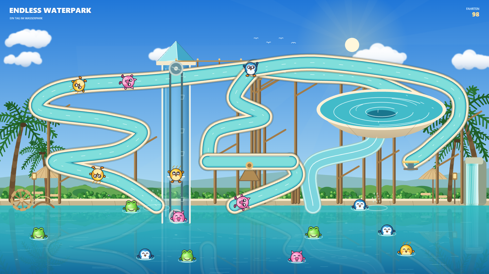

# Endless Waterpark – Umsetzung vom 16. November 2026

Der am 15. November erstellte [Plan](WASSERPARK_PLAN_2026-11-15.md) wurde mit dem Auftrag
„Ja setze den Plan um“ umgesetzt. Das neue Szenario heißt **Endless Waterpark**, ID `waterpark`.
Es steht in der lokalen Szenarioauswahl mit eigenen Short- und Langvideo-Knöpfen bereit.

Ausgangsstand: `09caa3d`, Arbeitsbranch `codex/waterpark`. Bereits vorhandene Änderungen an
Pyramide, Wasserklang, Export und Dokumentation wurden vor Beginn separat erfasst und erhalten.
Vergleichsbasis: `output/waterpark-dev/baseline.patch`, `baseline-status.txt` und `pyramid-before.js`.
Nach Abschluss der Prüfung hat der Nutzer Commit und Push des geprüften Projektstands
beauftragt. Die Übergabe auf `codex/waterpark` umfasst auch die bereits vorhandenen,
teilweise überlappenden Pyramiden- und Wasserklang-Anpassungen. Lokale Filmproben und
Testausgaben unter `output/` bleiben außerhalb des Git-Commits.

## Implementierter Umfang

- Die vier originalen Pyramid-Tierchen: Küken, Pinguin, Schweinchen und Frosch einschließlich
  Mimik, Armen, Beinen, Schwimmen, Rollen, Jubeln und Schlafmützen.
- Eigene Grundrisse für 16:9 und 9:16: Glaslift mit Pyramidendach, Startplattform,
  Panoramarutsche, offener Trichter mit durchsichtigem Auslauf, kippende Wippe und federndes
  Sprungbrett mit Flugphase. Die Tiere bleiben im sichtbaren Kreislauf erhalten.
- Drei Abläufe: Vier-Tiere-Short mit einer eigenen Attraktion je Tier, Parktag mit gestaffelten
  Öffnungen und geordnetem Parkschluss sowie endloser ruhiger Betrieb.
- Tageslicht, Abend und Nacht; Wolken, Sonne, Mond, Sterne, Ballon, Vögel, UFO und Sternschnuppen;
  Palmen, Pflanzen, Schirme, Wasserfall, Wasserrad, Steg, Fische, Sprechblasen und Glühwürmchen.
  Das UFO wird hinter der Anlage gezeichnet.
- Ruhiger Abschluss oder kurze Fontänenshow, separat schaltbares Feuerwerk.
- Durchgehender Wasserhintergrund mit leisen Aktionsklängen und getrennten Lautstärkereglern.
  Eigenes Mischprofil `waterpark-water-v1`, keine Musik und keine gesprochene Erzählung.
- Einstellungen speichern/laden, Neustart bei Änderung des Ablaufs oder der Episodendauer,
  MP4/H.264 mit Stereo-AAC und vorhandene Export-Metadaten.

Die Grafik verwendet die vorhandenen Canvas-Zeichenbausteine. Das frühere KI-Mockup bleibt ein
Gestaltungsvorschlag; die folgenden Bilder stammen aus dem tatsächlich laufenden Szenario.

[Hochformat mit vier Freunden](nachweise/waterpark_short_9x16_2026-11-16.png) ·
[UFO am Abend](nachweise/waterpark_ufo_16x9_2026-11-16.png) ·
[Nächtliche Fontänenshow](nachweise/waterpark_finale_16x9_2026-11-16.png)

## Vorlagen und Bedienung

In der Szenarioauswahl **Endless Waterpark** wählen. Die normale Vorschau beginnt im
Dauerbetrieb, damit auch eine beliebige kurze Vorschauzeit funktioniert. Die Knöpfe **Short**
und **Langvideo** laden ausdrücklich die entsprechenden vollständigen Abläufe.

| Vorlage | Ablauf | Ausgabe |
|---|---|---|
| [Produktions-Short](../presets/production/waterpark-short.json) | Vier Tiere, vier Attraktionen, gemeinsamer Abschluss | 30 s, 9:16, 1080p60 |
| [Produktions-Langvideo](../presets/production/waterpark-long.json) | Parktag mit ruhigem Abend | 10 min, 16:9, 1080p60 |
| [5 Minuten](../presets/waterpark-day-5min.json), [10 Minuten](../presets/waterpark-day-10min.json), [20 Minuten](../presets/waterpark-day-20min.json) | Parktag | 16:9, 1080p60 |
| [10 Minuten](../presets/waterpark-relax-10min.json), [20 Minuten](../presets/waterpark-relax-20min.json) | Dauerbetrieb ohne Sammelschluss | 16:9, 1080p60 |

Format, Zahl und Größe der Tiere, Geschwindigkeiten, offene Attraktionen, Tageslicht, Gäste,
Effekte und Lautstärken bleiben einstellbar. Im Vier-Tiere-Short sind alle vier Attraktionen
aktiv. Vor dem Export eines Shorts oder Parktags simuliert eine Vorprüfung den Ablauf: Zu
kurze oder zu langsame Einstellungen erzeugen eine verständliche Meldung, bevor ein
unvollständiges MP4 geschrieben wird. Die gewählte Filmlänge wird dabei nicht still verlängert.

## Architektur und Erhalt der Pyramide

`src/scenarios/waterpark.js` registriert das Szenario. `waterpark/layout.js`, `simulation.js`,
`story.js` und `renderer.js` trennen Wege, festen Simulationsschritt, Videoprogramm und Darstellung.
`shared/critter-art.js` enthält ausschließlich die tatsächlich gemeinsam verwendeten Tiere und
Kulissenhelfer. Es gibt keine neue allgemeine Grafik- oder Physikengine.

Die Tiere bewegen sich mit 60 festen Schritten je Videosekunde; das Bewegungstempo wirkt
zusätzlich auf die zurückgelegte Strecke. Tag, Parköffnungen, Dekoration, Ton und Finale folgen
der Videouhr. Darstellung und Dekorationsschalter verändern die Fahrten nicht. Ereignislisten,
Spritzer und Himmelsgäste bleiben begrenzt.

Der gemeinsame Zeichencode wurde gegen die gesicherte Pyramidenfassung verglichen: 240
Tierkombinationen und sechs Kulissenbilder pixelgleich, Zufallszustände unverändert. Acht
vollständige Pyramidenkonfigurationen hatten identische Zustände. Kleine Rasterabweichungen in
drei Nachtbildern ließen sich mit der unveränderten Originalfassung reproduzieren; die aktuelle
Fassung entsprach jeweils deren wiederholter Aufnahme. Nachweise liegen unter
`output/waterpark-dev/shared-art-extraction-verification.json` und `pyramid-scene-preservation.json`.

## Prüfungen

**Gesamtprüfung abgeschlossen: alle 289 Testfälle erfolgreich abgedeckt.** Der vollständige
Windows-Lauf (`npm test`) dauerte 38:02 Minuten: 263 bestanden, 26 aufgrund der lokalen
Netzwerksperre fehlgeschlagen, keine übersprungenen oder abgebrochenen Fälle. Alle 26 betroffenen
Fälle bestanden anschließend unverändert mit lokalem Netzwerkzugriff (Details unten). Dies ist
ein vollständiger Gesamtlauf plus gezielte erfolgreiche Wiederholungen, kein einzelner grüner Lauf.
Log: `output/waterpark-dev/full-test.log`. Es wurden keine Testgrenzen erhöht oder Referenzen neu gesetzt.

- **17/17 Simulationsprüfungen:** vollständige Short-Abläufe, 24 Tiere bei maximaler Größe und
  langsamen Einstellungen, jede Route allein, reproduzierbarer Seed, gleiche Zustände bei 30/60 fps,
  stetige Übergänge, reservierte Landebuchten, geordnetes Sammeln, begrenzte Dekoration und
  Abschlussvorprüfung. Die Routenwahl nutzt die hohen Hash-Bits, damit die erste Tiergruppe des
  Standard-Seeds nicht ungewollt dieselbe Rutsche bevorzugt.
- **7/7 Integrationsprüfungen:** Registrierung, Einstellungen, Vorlagen, Neustart bei Daueränderung,
  PNG-Aufnahme, AAC-Export und Ablehnung unvollständiger endlicher Filme.
- **2/2 Browserprüfungen:** echte bewegte Frames in beiden Formaten, 30/60-fps-Gleichheit,
  JSON-Roundtrip, Formatwechsel und Oberfläche bei 390 px Breite.
- **Sieben lange Vorlagenläufe:** 105 simulierte Minuten, 6.314 Zustandsprüfungen. Alle endlichen
  Abläufe enden vollständig; alle vier Attraktionen werden benutzt. Der 1024-Ereignisring bleibt
  begrenzt, beobachtet wurden höchstens 16 jüngste Ereignisse und drei Dekorationen gleichzeitig.
  Finale Ruhephase bei den geprüften Parktagen: etwa 26–29 Sekunden. Nachweis mit Quellprüfsummen:
  `output/waterpark-dev/long-simulation.json`.
- **Bestehende Simulationsreferenzen:** `npm run golden`, 36 Fälle mit zwei Prüfpunkten,
  unverändert gegenüber der Referenz. Log: `output/waterpark-dev/golden.log`.

| Lange Vorlage | Format | Abgeschlossene Fahrten | Alle Tiere angekommen |
|---|---|---:|---:|
| Parktag 5 min | 16:9 | 99 | 270,90 s |
| Parktag 10 min | 16:9 | 231 | 571,17 s |
| Parktag 20 min | 16:9 | 495 | 1173,12 s |
| Parktag 20 min | 9:16 | 564 | 1173,52 s |
| Dauerbetrieb 10 min | 16:9 | 200 | fortlaufend, mindestens 16 Fahrten je Tier |
| Dauerbetrieb 20 min | 16:9 | 405 | fortlaufend, mindestens 33 Fahrten je Tier |
| Dauerbetrieb 20 min | 9:16 | 487 | fortlaufend, mindestens 39 Fahrten je Tier |

Die Laufzeitbilder zeigen Tag, Abend, Short-Fahrten, Sammeln, UFO und Show. Eine Bildfolge aus
60 tatsächlich gerenderten Frames bewegt sich sichtbar und erreicht denselben Zustand wie
reine Simulation. Die abschließenden MP4-Proben werden zusätzlich als dekodierte Bildfolgen
geprüft; das ist kein persönliches Hörurteil.

Der echte Bedienweg über den lokalen Server wurde bereits vollständig geprüft:
Szenarioauswahl → Einstellungen → Exportknopf → POST `/api/export` (202) → Statusabfrage
→ fertiges MP4 und JSON → Download und Browserwiedergabe. Die 3-s-Probe enthält 90 Frames,
1280 × 720, H.264, Stereo-AAC mit 48 kHz und keine verlorenen Tonereignisse. MP4-Download und
Konfiguration stimmen mit den erzeugten Dateien überein; Bereichsanfragen liefern korrekt 206.
Keine Seiten- oder Netzwerkfehler. Der nur für die Prüfung gestartete Server wurde beendet.
Nachweis: `output/waterpark-dev/http-flow.json`.

Die 22 bestehenden HTTP-Prüfungen (acht Live-Tests und je zwei Produktionswege für die sieben
bereits vorhandenen Szenarien) konnten im eingeschränkten Gesamtlauf wegen gesperrter lokaler
Verbindungen nicht auf ihre Testserver zugreifen. Unverändert mit lokalem Netzwerkzugriff
wiederholt: **22/22 bestanden**, keine übersprungenen oder abgebrochenen Fälle. Anwendung,
Assertions und Zeitlimits blieben dabei unverändert; alle eigenen Testserver wurden beendet.
Nachweis: `output/waterpark-dev/http-regression.log`.
Vier weitere betroffene HTTP-Oberflächentests wurden anschließend ebenfalls unverändert
wiederholt: `test/settings.test.mjs` **5/5 bestanden** (einschließlich des bereits bestandenen
Datei-Roundtrips). Damit sind 26 Netzwerkfehler aus dem eingeschränkten Lauf durch erfolgreiche
Wiederholungen geklärt. Nachweis: `output/waterpark-dev/settings-regression.log`.

## Kurze Filmproben

Zwei tatsächliche MP4s des Dauerbetriebs mit Seed 42 und zwölf Tieren, jeweils **20 Sekunden,
1080p30, 600 Frames, H.264 und Stereo-AAC**. Die zugehörigen JSON-Dateien enthalten die vollständige
Konfiguration und Prüfsummen. Sechs dekodierte Zeitpunkte je Film wurden als Bildfolge geprüft;
sichtbar sind Lift, Verteilung, verschiedene Attraktionen, Wasserbewegung und Landungen.

| Lokale Filmdatei | Finale AAC-Lautheit | True Peak | Tonereignisse / verloren |
|---|---:|---:|---:|
| [20 s Querformat](../output/waterpark-dev/waterpark-preview-16x9-20s.mp4) | −24,3 LUFS | −7,1 dBTP | 33 / 0 |
| [20 s Hochformat](../output/waterpark-dev/waterpark-preview-9x16-20s.mp4) | −24,3 LUFS | −7,0 dBTP | 42 / 0 |

Die leise Mischung ist beabsichtigt. Gemessen wurde `audio.encoded`, also das endgültige AAC
einschließlich Wasserhintergrund; die separat protokollierten Aktionspegel sind keine Gesamtlautheit.
Beide Software-Exporte brauchten unter gleichzeitig laufender Testsuite etwa 4:15 Minuten. Das
ist kein isolierter Leistungsbenchmark und keine Hochrechnung für einen Export mit Grafikkarte.

## Grenzen der Abnahme

- Die komplette Filmproduktion eines 30-s-Shorts oder 5–20-Minuten-Videos wurde nicht ausgelöst.
  Lange reine Simulationen und kurze Filmproben ersetzen keine Sichtung eines ganzen Langfilms.
- Hörurteil auf Lautsprechern/Kopfhörern und Bedienung auf einem echten Handy bleiben offen.
  AAC-Pegel, Synchronität, Kanäle und Ereignisverlust werden technisch gemessen.
- Der Wasserpark hat noch keinen freigegebenen Ausschnittsexport (`supportsClips: false`).
  1:1 hat keinen eigens gestalteten Grundriss.
- Rennen, Wertung, Auftragsmodus, weitere Module und Nahkameras gehören zu den ausdrücklich
  späteren Erweiterungen des Plans. Die übrigen Tierchen-Ideen bleiben unter R29 vorgemerkt.

Offene Aufgaben und persönliche Abnahmen werden ausschließlich in der [Roadmap](ROADMAP.md) geführt.
